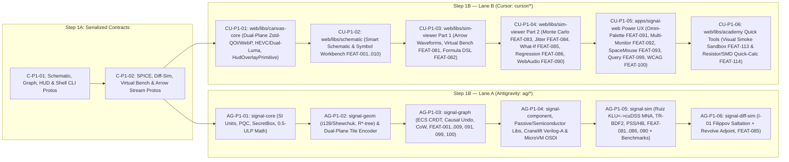

# Phase 1 Plan — Pure-Rust Modular Component Engine, Equilibrated/Differentiable MNA SPICE & Schematic Workbench

> **Phase Goal:** Build Signal's deterministic Pure-Rust `1.100+` physics foundation (`signal-core`, `signal-geom`, `signal-graph`, `signal-component`, `signal-lib-passive`, `signal-lib-semiconductor`, `signal-module-sdk`, `signal-sim`, `signal-diff-sim` `I-01`) and the Angular `v22+` Dual-Plane `Zstd-QOI`/WebP Canvas, Smart Schematic IDE (`FEAT-001`–`FEAT-010`), Arrow-streamed Waveform & Virtual Bench Studio (`FEAT-081`–`FEAT-086`, `FEAT-090`), Power-User Shell UX (`FEAT-091`–`FEAT-093`, `FEAT-099`, `FEAT-100`), and Academy Quick Tools (`FEAT-113`, `FEAT-114`).  
> **Governing Specs:** [`01`](../architecture/01-product-vision-and-features.md), [`03`](../architecture/03-rust-eda-engine.md), [`06`](../architecture/06-frontend-angular-and-fastapi-control-plane.md), [`16`](../architecture/16-architectural-audit-flaws-and-futuristic-innovations.md), [`17`](../architecture/17-extended-feature-specifications-ui-and-rust.md)  
> **Ledgers to Tick:** [`TODO-LEDGER-SHARED-CONTRACTS.md`](./TODO-LEDGER-SHARED-CONTRACTS.md) • [`TODO-LEDGER-ANTIGRAVITY-LANE-A.md`](./TODO-LEDGER-ANTIGRAVITY-LANE-A.md) • [`TODO-LEDGER-CURSOR-LANE-B.md`](./TODO-LEDGER-CURSOR-LANE-B.md)

---

## 1. Execution Wave Order

---

## 2. Step 1A — Serialized Contract Freeze (`contracts/**` ONLY)

### `C-P1-01` — Schematic, Design-Graph CRDT, `HudOverlayPrimitive` & Command-DSL Contracts
- **Branch:** `contract/C-P1-01-schematic-and-hud-protos` | **Touched Paths:** `contracts/proto/signal/v1/{design_graph,render_stream,component}.proto`, `contracts/fixtures/schematic_*.json`
- **Skills:** `signal-contract-first`, `signal-verification-and-pr-gate`
- **Deliverables:** Complete RPCs and `bigint` SI messages for `FEAT-001`..`FEAT-010`, `FEAT-091`..`FEAT-093`, `FEAT-099`, `FEAT-100`, `HudOverlayPrimitive` batches, and Dual-Plane `Zstd-QOI`/WebP + `HEVC 4:4:4`/Dual-Luma capability negotiation (`F-126`).
- **Verify & Tick:** `./signal.sh check --target contracts` → Tick `C-P1-01` in [`TODO-LEDGER-SHARED-CONTRACTS.md`](./TODO-LEDGER-SHARED-CONTRACTS.md).

### `C-P1-02` — MNA SPICE, Differentiable Adjoint (`I-01`), Virtual Bench & Arrow Waveform Contracts
- **Branch:** `contract/C-P1-02-spice-and-waveform-protos` | **Touched Paths:** `contracts/proto/signal/v1/simulation.proto`, `contracts/fixtures/simulation_*.json`, `contracts/transcripts/spice_buck_converter.jsonl`
- **Skills:** `signal-contract-first`, `signal-verification-and-pr-gate`
- **Deliverables:** Complete RPCs and `<= 1 MB` Apache Arrow IPC streaming contracts for DC/AC/Transient/Noise/PSS/HB/Monte-Carlo, Filippov Saltation Adjoint sensitivity (`I-01`), `FEAT-081`..`FEAT-086`, `FEAT-090`, `FEAT-113`, `FEAT-114`.
- **Verify & Tick:** `./signal.sh check --target contracts` → Tick `C-P1-02` in [`TODO-LEDGER-SHARED-CONTRACTS.md`](./TODO-LEDGER-SHARED-CONTRACTS.md).

---

## 3. Step 1B — Lane A: Antigravity Parallel Tasks (`ag/*`)

### `AG-P1-01` — `signal-core`: Strongly-Typed SI Units, Hybrid PQC, `SecretBox<T>`, `0.5-ULP` Math & Quick Calculators
- **Branch:** `ag/AG-P1-01-signal-core` | **Touched Paths:** `engine/crates/signal-core/**`
- **Skills:** `signal-rust-crate-architect`, `signal-rust-physics-and-geometry`, `signal-security-isolation-audit`
- **Deliverables:**
  1. Strongly-typed SI units (`Nanometers(i64)`, `Picoseconds(i64)`, `Microvolts(i64)`, `Nanoamps(i64)`) + unambiguous SPICE unit parser (`m` = `10^-3` vs `M`/`Meg` = `10^6`, `F-075`).
  2. Cross-ISA deterministic `0.5-ULP` software math (`core_math` `exp`/`log`/`sin`/`cos`, forbidden unplanned FMA contraction so ARM64 Mac == x86_64 Linux bit-for-bit, `F-033`).
  3. Hybrid PQC (`X25519 + ML-KEM-768`, `Ed25519 + ML-DSA-65`) + 2-level `HKDF-SHA512` (`F-078`, `F-140`, `I-11`) + `SecretBox<T>` (`ZeroizeOnDrop`, redacted `Debug`/`Display`, `F-088`).
  4. Parametric equation evaluator (`signal-core::expr_solver` for `FEAT-010`) & E-series resistor/SMD/divider/LED/PCB-trace calculators (`signal-core::eng_calculators` for `FEAT-114`).
- **Verify & Tick:** `./signal.sh check --target rust-pod` → Tick `AG-P1-01` in [`TODO-LEDGER-ANTIGRAVITY-LANE-A.md`](./TODO-LEDGER-ANTIGRAVITY-LANE-A.md).

### `AG-P1-02` — `signal-geom` (`i128`/Shewchuk, R*-Tree, 6-DOF Camera) & Dual-Plane `Zstd-QOI`/WebP Tile Renderer
- **Branch:** `ag/AG-P1-02-geom-and-tile-renderer` | **Touched Paths:** `engine/crates/signal-geom/**`, `engine/crates/signal-pod/src/render/**`
- **Skills:** `signal-rust-physics-and-geometry`, `signal-zero-leak-canvas-and-dlp`, `signal-verification-and-pr-gate`
- **Deliverables:**
  1. `signal-geom`: Exact `i128` fixed-point coordinates (`1 nm = 1`), Shewchuk adaptive exact `orient2d`/`incircle` predicates, bulk-loaded R*-tree spatial index, Euler clothoid/spline curves (`F-030`, `F-031`), and 6-DOF camera quaternion controller (`FEAT-093`).
  2. `signal-pod::render`: Server-side `wgpu` composited multi-pane viewport atlas (`F-067`), Dual-Plane lossless `Zstd-QOI`/WebP `RGBA8` dirty-tile encoder (`80 ms` crisp settling frame) + hardware-probed `HEVC 4:4:4` / Dual-Luma `AV1` motion stream (`F-066`, `F-126`), and multi-monitor secondary viewport multiplexer (`FEAT-092`).
- **Verify & Tick:** `./signal.sh check --target rust-pod` (including `lavapipe` headless WGSL test) → Tick `AG-P1-02` in [`TODO-LEDGER-ANTIGRAVITY-LANE-A.md`](./TODO-LEDGER-ANTIGRAVITY-LANE-A.md).

### `AG-P1-03` — `signal-graph`: ECS Design Graph, Topological CRDT, Selective Undo, CoW & Schematic Operations (`FEAT-001`–`009`, `091`, `099`, `100`)
- **Branch:** `ag/AG-P1-03-signal-graph-and-schematic-ops` | **Touched Paths:** `engine/crates/signal-graph/**`
- **Skills:** `signal-rust-crate-architect`, `signal-rust-physics-and-geometry`, `signal-verification-and-pr-gate`
- **Deliverables:**
  1. In-memory generational-arena ECS graph with **Topological-Invariant CRDT** (rejects concurrent power-rail `VCC`↔`GND` shorting or multi-driver collisions into an interactive Conflict Resolution Card, `F-040`, `F-124`), per-user causal dependency-tracking selective Undo/Redo (`F-041`, `F-124`), and Copy-on-Write (`im`/`rpds`) $O(1)$ speculative AI branches (`F-044`).
  2. Rust kernels for **`FEAT-001`** (`beautify` Sugiyama + A* orthogonal untangler), **`FEAT-002`** (`bus_bundle` typed bus slices & protocol fanout), **`FEAT-005`** (`hierarchy_index` cross-sheet portals), **`FEAT-006`** (`multi_channel` `Repeat(N)` hierarchy), **`FEAT-007`** (`variants` DNP/stuffing evaluator), **`FEAT-008`** (`swap_equivalence` bipartite pin/gate swapper), **`FEAT-009`** (`reannotate` spatialsweep refdes map), **`FEAT-091`** (`command_dsl` `nom` parser for Omni-Palette), **`FEAT-099`** (`query_engine` topological filter/bulk mutation), and **`FEAT-100`** (`a11y_tree` WCAG spatial screen-reader & keyboard A* wiring).
- **Verify & Tick:** `./signal.sh check --target rust-pod` → Tick `AG-P1-03` in [`TODO-LEDGER-ANTIGRAVITY-LANE-A.md`](./TODO-LEDGER-ANTIGRAVITY-LANE-A.md).

### `AG-P1-04` — `signal-component`, Passive/Semiconductor Libraries, AOT Cranelift Verilog-A & Child-MicroVM `OSDI`/`IBIS-AMI`
- **Branch:** `ag/AG-P1-04-component-engine-and-libs` | **Touched Paths:** `engine/crates/{signal-component,signal-lib-passive,signal-lib-semiconductor,signal-module-sdk}/**`
- **Skills:** `signal-rust-physics-and-geometry`, `signal-security-isolation-audit`, `signal-verification-and-pr-gate`
- **Deliverables:**
  1. `ElectronicModule` trait: exact `q(v)`/`Φ(i)` charge/flux-conserving state vectors (`F-024`), analytical + dual-number Jacobians, tolerances, TCR, parasitics, dynamic electro-thermal self-heating (`P = V*I -> T_j`), SOA watchdog (`FEAT-113` `soa_failure_event` with peak energy/smoke coordinates), and fault injection (`Open`/`Short`/`ParametricDrift`/`StuckAt`).
  2. `signal-lib-passive` (Resistors, DC-bias/temp MLCCs, saturating Inductors, coupled Transformers) & `signal-lib-semiconductor` (Diodes, BJTs, BSIM4/BSIM-CMG/EKV MOSFETs, SiC/GaN HEMTs, Op-Amps, LDOs, PWM Buck/Boost, Logic/ADC/DAC).
  3. `signal-module-sdk`: Multi-dialect SPICE parser (NGSPICE/LTspice/PSpice/Spectre/HSPICE, `F-029`), **AOT Cranelift Pure-Rust Verilog-A compiler** (zero C++ LLVM in `signal-pod`!, `F-115`), and **isolated zero-network Child-MicroVM shared-memory IPC runner** for third-party binary `OSDI` / `IBIS-AMI` models (`F-114`).
- **Verify & Tick:** `./signal.sh check --target rust-pod` → Tick `AG-P1-04` in [`TODO-LEDGER-ANTIGRAVITY-LANE-A.md`](./TODO-LEDGER-ANTIGRAVITY-LANE-A.md).

### `AG-P1-05` — `signal-sim` Equilibrated MNA SPICE (`KLU`↔`cuDSS`), PSS/HB, Virtual Instruments (`FEAT-003`, `004`, `081`–`086`, `090`) & Golden Benchmarks
- **Branch:** `ag/AG-P1-05-signal-sim-and-benchmarks` | **Touched Paths:** `engine/crates/signal-sim/**`, `benchmarks/spice/**`
- **Skills:** `signal-rust-physics-and-geometry`, `signal-verification-and-pr-gate`
- **Deliverables:**
  1. Ruiz matrix equilibration + `f64`/`f128` iterative refinement (`F-023`), $C^2$-smooth `limexp`/`pnjlim` + Gmin/source stepping (`F-025`), adaptive **TR-BDF2 / Gear-2** stiff integrator with algebraic-loop regularizer (`F-026`, `F-027`), **Automatic CPU `KLU`/`CKTSO` (`< 25k` nodes) ↔ GPU `cuDSS`/batched Krylov (`>= 25k` or Monte-Carlo) dispatcher** (`F-116`), and **Shooting-Newton PSS + Harmonic Balance (HB)** (`F-028`).
  2. Rust kernels for **`FEAT-003`** (`interactive_step` warm-Factorization live slider updates), **`FEAT-004`** (`branch_telemetry` RMS/peak current river vectors), **`FEAT-081`** (`virtual_instruments` FFT/Blackman-Harris/THD/SINAD/Smith Z-Y), **`FEAT-082`** (`wave_expr` Rayon SIMD trace calculator), **`FEAT-083`** (`yield_analytics` LHS/Sobol Monte Carlo + Spearman tornado), **`FEAT-084`** (`jitter_ber` Dual-Dirac RJ/DJ/PJ/DDJ & PAM4 bathtub), **`FEAT-086`** (`regression_runner` headless spec-assertion matrix), and **`FEAT-090`** (`stimulus_gen` PRBS/ISO-7637/WAV resampler).
  3. `benchmarks/spice/`: Continuous **NGSPICE/XYCE Golden Parity Suite** (series/parallel chains, RLC filters, BJT/MOSFET stages, 2 MHz GaN synchronous buck converter `< 0.2%` error, `F-110`).
- **Verify & Tick:** `./signal.sh check --target rust-pod && cargo test --manifest-path engine/Cargo.toml -p signal-sim` → Tick `AG-P1-05` in [`TODO-LEDGER-ANTIGRAVITY-LANE-A.md`](./TODO-LEDGER-ANTIGRAVITY-LANE-A.md).

### `AG-P1-06` — `signal-diff-sim` (`I-01`): Filippov Saltation Matrices, `Revolve` Adjoint Checkpointing & Fast What-If Sweeps (`FEAT-085`)
- **Branch:** `ag/AG-P1-06-signal-diff-sim` | **Touched Paths:** `engine/crates/signal-diff-sim/**`
- **Skills:** `signal-rust-physics-and-geometry`, `signal-verification-and-pr-gate`
- **Deliverables:**
  1. End-to-End Differentiable SPICE (`I-01`, `F-034`, `F-113`): Exact **Filippov / Sensitivity Saltation Matrices** at every PWM comparator, diode commutation, and MOSFET switching threshold crossing.
  2. **`Revolve` Binomial $O(\log N_t)$ Time-Step Checkpointing** (`~40` RAM snapshots for `100,000` transient steps + cubic Hermite interpolation) + Two-Stage PSS/HB warm-start before adjoint fine-tuning.
  3. `signal-diff-sim::fast_sweep` Taylor/Adjoint + parallel `KLU` batch evaluator powering **`FEAT-085`** (`< 15 ms` live What-If Scrubber curves).
- **Verify & Tick:** `./signal.sh check --target rust-pod` (finite-difference vs. Saltation-Adjoint gradient parity `< 1e-6`) → Tick `AG-P1-06` in [`TODO-LEDGER-ANTIGRAVITY-LANE-A.md`](./TODO-LEDGER-ANTIGRAVITY-LANE-A.md).

---

## 4. Step 1B — Lane B: Cursor Parallel Tasks (`cursor/*`)

### `CU-P1-01` — `web/libs/canvas-core`: Dual-Plane `Zstd-QOI`/WebP Receiver, `HudOverlayPrimitive` 120 FPS Layer & Volatile Reconnect Buffer
- **Branch:** `cursor/CU-P1-01-canvas-core` | **Touched Paths:** `web/libs/canvas-core/**`
- **Skills:** `signal-zero-leak-canvas-and-dlp`, `signal-angular-workbench`, `signal-angular-ui-style-system`
- **Deliverables:**
  1. Capability-probed (`navigator.mediaCapabilities.decodingInfo()`) Dual-Plane stream client: lossless `Zstd-QOI`/WebP `RGBA8` dirty-tile decoder + hardware `HEVC 4:4:4` / Dual-Luma `AV1` motion stream over Envoy HTTP/3 WebTransport → `turns:443` → HTTP/2 WSS fallback (`F-066`..`F-068`, `F-072`, `F-126`).
  2. 120 FPS client-side `HudOverlayPrimitive` WebGPU/Canvas2D renderer (rubber-band wires, snap guides, cursors, hover badges), **Volatile JS Heap Reconnect Ring-Buffer** (`<= 60 s` uncommitted `GraphOp`s with `Idempotency-Key`, zero disk/IndexedDB!, `F-071`), and **Pod-to-Pod Encrypted Cloud Clipboard** client (`F-073`).
- **Verify & Tick:** `./signal.sh check --target ui` → Tick `CU-P1-01` in [`TODO-LEDGER-CURSOR-LANE-B.md`](./TODO-LEDGER-CURSOR-LANE-B.md).

### `CU-P1-02` — `web/libs/schematic`: Smart Schematic & Symbol Workbench (`FEAT-001`–`FEAT-010`)
- **Branch:** `cursor/CU-P1-02-schematic-workbench` | **Touched Paths:** `web/libs/schematic/**`
- **Skills:** `signal-angular-workbench`, `signal-angular-ui-style-system`, `signal-zero-leak-canvas-and-dlp`
- **Deliverables:**
  1. Strict 4-file (`.component.ts`/`.html`/`.logic.ts`/`.model.ts`, `@signal/design-system` + `@signal/ui-kit` styles only) Schematic Workbench implementing:
     - **`FEAT-001`** (`BeautifyPreviewDirective`), **`FEAT-002`** (`BusBundleCanvasOverlay` + `BundleInspectorPanel`), **`FEAT-003`** (`LiveControlWidgetLayer` rotary pots/switches/faults), **`FEAT-004`** (`CurrentRiverHudToggle` animated particles & SOA badges), **`FEAT-005`** (`NetPortalPopoverComponent` cross-sheet minimap), **`FEAT-006`** (`ChannelMatrixTableComponent` `Repeat(N)`), **`FEAT-007`** (`VariantSelectorToolbar` DNP curtain), **`FEAT-008`** (`PinSwapDragController`), **`FEAT-009`** (`ReannotateDialogComponent`), and **`FEAT-010`** (`CanvasEquationBlockComponent` KaTeX cards).
- **Verify & Tick:** `./signal.sh check --target ui` → Tick `CU-P1-02` in [`TODO-LEDGER-CURSOR-LANE-B.md`](./TODO-LEDGER-CURSOR-LANE-B.md).

### `CU-P1-03` — `web/libs/sim-viewer` (Part 1): Arrow-Streamed Waveform Canvas, Virtual Bench (`FEAT-081`) & Formula DSL (`FEAT-082`)
- **Branch:** `cursor/CU-P1-03-sim-viewer-bench-and-dsl` | **Touched Paths:** `web/libs/sim-viewer/src/lib/{waveform-canvas,virtual-bench,formula-bar}/**`
- **Skills:** `signal-angular-workbench`, `signal-angular-ui-style-system`, `signal-verification-and-pr-gate`
- **Deliverables:**
  1. Server-decimated `<= 4,096`-pixel Apache Arrow IPC streaming waveform canvas (`F-069`, `F-101`) with cross-probing to schematic nets/pins.
  2. **`FEAT-081`** (`VirtualBenchDeckComponent`: 4-ch DSO, 32-ch Logic Analyzer, FFT Spectrum Analyzer with RBW/THD/ENOB, 2-Port VNA Smith Chart) & **`FEAT-082`** (`WaveformFormulaBar`: autocomplete math DSL `integrate(v(out)*i(L1))`, `fft_db()`, `group_delay()`).
- **Verify & Tick:** `./signal.sh check --target ui` → Tick `CU-P1-03` in [`TODO-LEDGER-CURSOR-LANE-B.md`](./TODO-LEDGER-CURSOR-LANE-B.md).

### `CU-P1-04` — `web/libs/sim-viewer` (Part 2): Monte Carlo (`FEAT-083`), Jitter/Bathtub (`FEAT-084`), What-If Scrubber (`FEAT-085`), Regression (`FEAT-086`) & WebAudio (`FEAT-090`)
- **Branch:** `cursor/CU-P1-04-sim-viewer-analytics` | **Touched Paths:** `web/libs/sim-viewer/src/lib/{monte-carlo,jitter-studio,what-if-scrubber,regression-suite,stimulus-audition}/**`
- **Skills:** `signal-angular-workbench`, `signal-angular-ui-style-system`, `signal-verification-and-pr-gate`
- **Deliverables:**
  1. **`FEAT-083`** (`MonteCarloAnalyticsStudio`: histograms, $C_{pk}$, Tornado bars, 2D scatter), **`FEAT-084`** (`SerDesJitterStudioComponent`: phase noise $\mathcal{L}(f)$, RJ/DJ/PJ/DDJ, PAM4 bathtub down to `10^-15`), **`FEAT-085`** (`WhatIfScrubberDrawer`: live 60 FPS Saltation-Adjoint ghost curves), **`FEAT-086`** (`RegressionSuiteConsole`: pass/fail margin table), and **`FEAT-090`** (`StimulusAuditionPanel`: in-memory `AudioContext` A/B audition with zero disk download).
- **Verify & Tick:** `./signal.sh check --target ui` → Tick `CU-P1-04` in [`TODO-LEDGER-CURSOR-LANE-B.md`](./TODO-LEDGER-CURSOR-LANE-B.md).

### `CU-P1-05` — `web/apps/signal-web` Power-User UX (`FEAT-091`–`093`, `099`, `100`)
- **Branch:** `cursor/CU-P1-05-shell-power-ux-and-a11y` | **Touched Paths:** `web/apps/signal-web/src/app/{omni-palette,multi-monitor,spacemouse,selection-query,accessibility}/**`
- **Skills:** `signal-angular-workbench`, `signal-angular-ui-style-system`, `signal-zero-leak-canvas-and-dlp`
- **Deliverables:**
  1. **`FEAT-091`** (`OmniPaletteComponent`: `Cmd+K` deterministic CLI action bar), **`FEAT-092`** (`MultiMonitorWindowManager`: `BroadcastChannel`-synced Zero-Leak pop-out windows with auto-wipe on session end), **`FEAT-093`** (`RadialPieMenuDirective` + `WebHidSpaceMouseService`), **`FEAT-099`** (`SelectionQueryToolbar`: `type:cap AND voltage_rating < 2*net_max_v`), and **`FEAT-100`** (`AccessibilityCadAdapter`: WCAG 2.2 AA keyboard-only CAD wiring, KiCad/Altium/Virtuoso/Vim keymaps, ARIA live netlist reader).
- **Verify & Tick:** `./signal.sh check --target ui` → Tick `CU-P1-05` in [`TODO-LEDGER-CURSOR-LANE-B.md`](./TODO-LEDGER-CURSOR-LANE-B.md).

### `CU-P1-06` — `web/libs/academy` Foundation: Visual Smoke Sandbox (`FEAT-113`) & Engineering Quick-Calculator HUD (`FEAT-114`)
- **Branch:** `cursor/CU-P1-06-academy-quick-tools` | **Touched Paths:** `web/libs/academy/src/lib/{visual-failure-fx,quick-calc-hud}/**`
- **Skills:** `signal-angular-workbench`, `signal-angular-ui-style-system`, `signal-verification-and-pr-gate`
- **Deliverables:**
  1. **`FEAT-113`** (`VisualFailureFxOverlay`: animated smoke/glow/pop tooltip explaining *why* a part failed SOA in `EXPLORER`/`MAKER` profiles + 1-click "Auto-Fix Component Rating") and **`FEAT-114`** (`QuickCalcHudDrawer`: 4/5/6-band resistor decoder, EIA-96 SMD decoder, divider/LED/op-amp/trace calculator with 1-click "Insert into Schematic").
- **Verify & Tick:** `./signal.sh check --target ui` → Tick `CU-P1-06` in [`TODO-LEDGER-CURSOR-LANE-B.md`](./TODO-LEDGER-CURSOR-LANE-B.md).
