# Phase 2 Plan — 3-Tier K8s Project Cells (`1–4 -> N` Nodes), BYO-Git Padmé Vault, Universal Parts Repo & Provider Auth

> **Phase Goal:** Deliver Signal's multi-provider Customer BYO-Git engine (`GitHub`, `GitLab`, `Bitbucket`) with Padmé-padded path-blinded `.signal/vault.merkle.sig` `AES-256-GCM-SIV` `ENCRYPTED_VAULT` & Dual-Fenced Two-Phase `Super-Commit` (`I-12`), socket-pinned `signal-egress-proxy`, `< 8 MB` `signal-cell-wasm` `EXPLORER` isolates, `signal-operator` across `1–4 -> N` extensible Rust worker nodes (Host-Aggregated Leases, `< 150 ms` Pre-Copy Live Migration, multi-version LTS pod routing, `H100 CC`/`B200 TEE-I/O` MIG `I-11`), the **3-Tier Universal Component, Datasheet, Symbol, Parametric Padstack & 3D STEP Repository (`18-*`, `FEAT-071`–`077`, `079`)**, Provider-Synced Auth/Access Review, and Spatial Review/Diff/Breadboard workbenches (`FEAT-094`, `097`, `098`, `111`, `119`).  
> **Governing Specs:** [`04`](../architecture/04-kubernetes-runtime-and-collaboration.md), [`07`](../architecture/07-security-encryption-dlp-and-sftp.md), [`08`](../architecture/08-identity-enterprise-and-project-model.md), [`13`](../architecture/13-vcs-git-server-and-storage-analysis.md), [`14`](../architecture/14-universal-scale-accessibility-and-expandability.md), [`15`](../architecture/15-application-security-and-project-isolation.md), [`17`](../architecture/17-extended-feature-specifications-ui-and-rust.md), [`18`](../architecture/18-universal-component-and-datasheet-repository.md), [`20`](../architecture/20-versioning-release-monorepo-build-and-k8s-topology.md)  
> **Ledgers to Tick:** [`TODO-LEDGER-SHARED-CONTRACTS.md`](./TODO-LEDGER-SHARED-CONTRACTS.md) • [`TODO-LEDGER-ANTIGRAVITY-LANE-A.md`](./TODO-LEDGER-ANTIGRAVITY-LANE-A.md) • [`TODO-LEDGER-CURSOR-LANE-B.md`](./TODO-LEDGER-CURSOR-LANE-B.md)

---

## 1. Execution Wave Order

```mermaid
flowchart LR
    subgraph Step2A["Step 2A: Serialized Contracts"]
        CP201["C-P2-01: BYO-Git, Super-Commit, K8s Session & Review Protos"] --> CP202["C-P2-02: Universal Parts (18-*), Padstack, STEP & Curve-Fitter Protos"]
    end
    subgraph Step2B_AG["Step 2B — Lane A (Antigravity: ag/*)"]
        AG201["AG-P2-01: signal-git-sync (Padme GCM-SIV Vault, 2PC Super-Commit, History Scrubber FEAT-097)"]
        AG202["AG-P2-02: signal-egress-proxy (Socket-Pinned Anti-SSRF + X-Signal-Fencing-Token Gate)"]
        AG203["AG-P2-03: signal-cell-wasm (<8MB EXPLORER), Presence FEAT-094, Breadboard FEAT-111 & Guest View FEAT-119"]
        AG204["AG-P2-04: signal-operator (Host Leases, <150ms Pre-Copy Migration, Multi-Version LTS, H100/B200 CC)"]
        AG205["AG-P2-05: signal-parts (3-Tier CAS/AVL, Master Pin Table, IEEE/IEC Symbols, Padstacks, IPC-7351, 5-Gate 3D STEP FEAT-071,072,075..077)"]
        AG206["AG-P2-06: signal-module-sdk Curve-Fitter (FEAT-073), WASM Component Sandbox (FEAT-074) & Golden Snippets (FEAT-079)"]
        AG201 --> AG202 --> AG203 --> AG204 --> AG205 --> AG206
    end
    subgraph Step2B_CU["Step 2B — Lane B (Cursor: cursor/*)"]
        CU201["CU-P2-01: services/identity-org (Dual SSO+PKCE, 2-of-3 Break-Glass, Contractor expires_at, 21 CFR Part 11)"]
        CU202["CU-P2-02: services/vcs-connector (<=40/min Lazy Repo Pacer, provider_repo_id) & services/vcs-auditor"]
        CU203["CU-P2-03: services/project-catalog (Multi-Type, Templates, SPDX) & services/session-broker (Paired-Region DR)"]
        CU204["CU-P2-04: services/parts-registry & web/libs/specs (3-Tier AVL Overlay, Provenance FEAT-077, BOM Matrix)"]
        CU205["CU-P2-05: web/libs/library-studio (Footprint/STEP Wizard FEAT-071, Symbol Splitter FEAT-072, Curve-Fitter FEAT-073, SDK FEAT-074, Padstack FEAT-076, Snippets FEAT-079)"]
        CU206["CU-P2-06: web/libs/{visual-diff,review,admin,academy} (History FEAT-097, Follow-Me FEAT-094, Stage-Gate FEAT-098, AVL FEAT-075, Partner Portal FEAT-119, Breadboard FEAT-111)"]
        CU201 --> CU202 --> CU203 --> CU204 --> CU205 --> CU206
    end
    CP202 --> AG201
    CP202 --> CU201
```

---

## 2. Step 2A — Serialized Contract Freeze (`contracts/**` ONLY)

### `C-P2-01` — BYO-Git, Dual-Fenced `Super-Commit`, K8s Session Lease & Spatial Review Contracts
- **Branch:** `contract/C-P2-01-vcs-and-session-protos` | **Touched Paths:** `contracts/proto/signal/v1/{vcs_sync,session}.proto`, `contracts/schemas/super-commit-manifest.schema.json`, `contracts/transcripts/super_commit_and_fencing.jsonl`
- **Skills:** `signal-contract-first`, `signal-byo-git-and-vault`, `signal-verification-and-pr-gate`
- **Deliverables:** Finalize `vcs_sync.proto` & `session.proto` for `GitProviderAdapter`, `provider_repo_id`, Padmé `.signal/vault.merkle.sig`, Dual-Fenced 2PC `Super-Commit`, `FEAT-094`, `FEAT-097`, `FEAT-098`, `FEAT-111`, `FEAT-119`.
- **Verify & Tick:** `./signal.sh check --target contracts` → Tick `C-P2-01` in [`TODO-LEDGER-SHARED-CONTRACTS.md`](./TODO-LEDGER-SHARED-CONTRACTS.md).

### `C-P2-02` — Universal Parts (`18-*`), Master Pin Table, Parametric Padstack, 3D STEP & Curve-Fitter Contracts
- **Branch:** `contract/C-P2-02-universal-parts-protos` | **Touched Paths:** `contracts/proto/signal/v1/universal_parts.proto`, `contracts/schemas/universal-part-manifest.schema.json`, `contracts/fixtures/universal_part_*.json`
- **Skills:** `signal-contract-first`, `signal-universal-parts-registry`, `signal-verification-and-pr-gate`
- **Deliverables:** Finalize `universal_parts.proto` (`UniversalComponentRevision`, `MasterPinRecord`, `SymbolGraphicAst` IEEE/IEC, `PadstackDef`, `FootprintPackageModel`, `PartVerificationReport`, `ProjectPartsLockfile`, and RPCs for `FEAT-071`..`FEAT-077`, `FEAT-079`).
- **Verify & Tick:** `./signal.sh check --target contracts` → Tick `C-P2-02` in [`TODO-LEDGER-SHARED-CONTRACTS.md`](./TODO-LEDGER-SHARED-CONTRACTS.md).

---

## 3. Step 2B — Lane A: Antigravity Parallel Tasks (`ag/*`)

### `AG-P2-01` — `signal-git-sync`: BYO-Git Engine, Padmé `AES-256-GCM-SIV` Vault, 2PC `Super-Commit` & History Scrubber (`FEAT-097`)
- **Branch:** `ag/AG-P2-01-signal-git-sync` | **Touched Paths:** `engine/crates/signal-git-sync/**`
- **Skills:** `signal-byo-git-and-vault`, `signal-rust-crate-architect`, `signal-security-isolation-audit`
- **Deliverables:**
  1. Pure-Rust `gitoxide`/`jj-lib` engine supporting **GitHub**, **GitLab**, and **Bitbucket** (`ORG_NAMESPACE` & `USER_NAMESPACE`), blobless `--filter=blob:none` partial clones + `64 KB` streaming LFS hydration (`F-015`, `F-121`), and live external `git push` webhook fetch + 3-way semantic auto-rebase (`F-122`).
  2. **Padmé-Padded, Path-Blinded (`blobs/<hmac_prefix>/<entity_hmac>.sigv`), Merkle-Root-Bound (`.signal/vault.merkle.sig`) RFC 8452 `AES-256-GCM-SIV` `ENCRYPTED_VAULT`** (`F-013`, `F-117`, `I-12`) + Dual-Fenced Two-Phase Cross-Repo `Super-Commit` (`refs/signal/txn/<id>` prepare → `<project>-meta` `.signal/repos.lock.json` CAS commit FIRST → member branch advance, `F-011`, `F-119`) + BYOK-wrapped ephemeral Continuity WAL (`F-141`).
  3. `signal-git-sync::history_scrubber` commit-graph delta walker for **`FEAT-097`** & `signal-pod::stage_gate_evaluator` for **`FEAT-098`**.
- **Verify & Tick:** `./signal.sh check --target rust-pod` → Tick `AG-P2-01` in [`TODO-LEDGER-ANTIGRAVITY-LANE-A.md`](./TODO-LEDGER-ANTIGRAVITY-LANE-A.md).

### `AG-P2-02` — `signal-egress-proxy`: Socket-Pinned Anti-SSRF & Linearizable `X-Signal-Fencing-Token` Gate
- **Branch:** `ag/AG-P2-02-signal-egress-proxy` | **Touched Paths:** `engine/crates/signal-egress-proxy/**`
- **Skills:** `signal-security-isolation-audit`, `signal-byo-git-and-vault`, `signal-rust-crate-architect`
- **Deliverables:**
  1. Authenticating outbound proxy enforcing **socket-level resolved-IP pinning on every `connect()`** (blocking RFC 1918, loopback, link-local `169.254.169.254`, K8s service CIDRs, and DNS rebinding TOCTOU, `F-089`).
  2. **Gate 1 External Fencing (`F-119`):** Verifies `X-Signal-Fencing-Token` against the shared Redis/etcd linearizable epoch registry on every outbound Git/LFS/BYO-S3 write, terminating zombie-pod connections before a single byte reaches GitHub/GitLab/Bitbucket.
- **Verify & Tick:** `./signal.sh check --target rust-egress-proxy` → Tick `AG-P2-02` in [`TODO-LEDGER-ANTIGRAVITY-LANE-A.md`](./TODO-LEDGER-ANTIGRAVITY-LANE-A.md).

### `AG-P2-03` — `signal-cell-wasm` (`< 8 MB` `EXPLORER` Isolates), Live Follow Presence (`FEAT-094`), Breadboard Twin (`FEAT-111`) & Partner Filter (`FEAT-119`)
- **Branch:** `ag/AG-P2-03-wasm-cells-and-collab-kernels` | **Touched Paths:** `engine/crates/signal-cell-wasm/**`, `engine/crates/signal-graph/src/{ephemeral_presence,breadboard_map}.rs`, `engine/crates/signal-pod/src/readonly_view_filter.rs`
- **Skills:** `signal-rust-crate-architect`, `signal-security-isolation-audit`, `signal-zero-leak-canvas-and-dlp`
- **Deliverables:**
  1. `signal-cell-wasm`: `< 8 MB` Wasmtime isolate with fuel/epoch interruption and `MemoryLimiter` packing `500–1,000` free-tier `EXPLORER` circuits per worker node (`F-138`), with `< 2 s` transparent live state promotion to a dedicated `signal-pod` MicroVM on scale-up.
  2. **`FEAT-094`** (`signal-graph::ephemeral_presence` 60 Hz camera/cursor/laser broadcast), **`FEAT-111`** (`signal-graph::breadboard_map` 5-hole strip connectivity bijection), and **`FEAT-119`** (`signal-pod::readonly_view_filter` stripping internal cost/notes/sub-sheets before Zero-Leak partner rendering).
- **Verify & Tick:** `./signal.sh check --target rust-cell-wasm` → Tick `AG-P2-03` in [`TODO-LEDGER-ANTIGRAVITY-LANE-A.md`](./TODO-LEDGER-ANTIGRAVITY-LANE-A.md).

### `AG-P2-04` — `signal-operator`: Host-Aggregated K8s Leases, `< 150 ms` Pre-Copy Live Migration, Multi-Version LTS Pods & `H100`/`B200` CC
- **Branch:** `ag/AG-P2-04-signal-operator` | **Touched Paths:** `engine/crates/signal-operator/**`, `infra/k8s/helm/signal/templates/operator-*.yaml`
- **Skills:** `signal-release-deploy-topology`, `signal-security-isolation-audit`, `signal-rust-crate-architect`
- **Deliverables:**
  1. `kube-rs` controller reconciling `ProjectSession` CRDs across **`1–4 -> N` extensible `pool-rust-engine` worker nodes** (`core-standard`, `core-highmem`, `core-gpu`, `core-confidential`, adaptive 1-node fallback, `20-*`).
  2. **Host-Aggregated K8s Node Leases** (`100x` fewer `etcd` writes, `F-139`), **3-Phase Pre-Copy Live Migration** (background dirty-page stream → `< 150 ms` cutover freeze, `F-046`, `F-123`), **Multi-Version Rust Pod Coexistence** (`.signal/platform.lock.json` LTS pinning + Envoy `signal-engine-bridge` sticky routing, `20-*`), predictive Warm Pool (`F-039`), and **Exclusive `H100 CC` vs. Blackwell `B200 TEE-I/O` Confidential MIG** scheduling (`F-079`, `F-118`, `I-11`).
- **Verify & Tick:** `./signal.sh check --target rust-operator` → Tick `AG-P2-04` in [`TODO-LEDGER-ANTIGRAVITY-LANE-A.md`](./TODO-LEDGER-ANTIGRAVITY-LANE-A.md).

### `AG-P2-05` — `signal-parts`: 3-Tier Universal Parts Resolver, Master Pin Table, IEEE/IEC Symbols, Padstacks, IPC-7351 & 5-Gate 3D STEP Verifier (`18-*`, `FEAT-071`, `072`, `075`–`077`)
- **Branch:** `ag/AG-P2-05-signal-parts-engine` | **Touched Paths:** `engine/crates/signal-parts/**`
- **Skills:** `signal-universal-parts-registry`, `signal-rust-physics-and-geometry`, `signal-verification-and-pr-gate`
- **Deliverables:**
  1. **3-Tier Federated Resolver (`18-*`):** Tier 1 Sharded Global Git (`00`..`ff`) + BLAKE3 CAS → Tier 2 Padmé-encrypted Org BYO-Git `<org>/signal-org-parts` AVL Overlay (zero NDA leak!) → Tier 3 Project `.signal/parts.lock.json` immutable hash/padstack lock.
  2. **Master Pin Table (`pins.json`) 3-Way Bijection Verifier** (Symbol ↔ Pad ↔ SPICE Port ↔ 3D STEP Lead, `F-064`), Dual-Standard **IEEE 315 & IEC 60617** Symbol Renderer + **`FEAT-072`** (`symbol_splitter` functional bank partitioner), **First-Class Parametric Padstack Engine (`PadstackDef` + `FEAT-076` thermal-relief/backdrill sculptor)**, **`FEAT-071`** (`ipc7351_step` IPC-7351C courtyard solver & watertight AP242 3D STEP generator), **5-Gate Automated `BRONZE`/`SILVER`/`GOLD` Verifier** (3D lead-to-pad intersection `>= 85%`, body clearance, ERC/SPICE smoke test), and **`FEAT-075`/`077`** (AVL where-used & distributor lineage verifier).
- **Verify & Tick:** `./signal.sh check --target rust-pod` → Tick `AG-P2-05` in [`TODO-LEDGER-ANTIGRAVITY-LANE-A.md`](./TODO-LEDGER-ANTIGRAVITY-LANE-A.md).

### `AG-P2-06` — `signal-module-sdk` Curve-Fitter (`FEAT-073`), WASM Component Sandbox (`FEAT-074`) & Golden Snippets (`FEAT-079`)
- **Branch:** `ag/AG-P2-06-curve-fitter-and-snippets` | **Touched Paths:** `engine/crates/signal-module-sdk/src/{curve_fitter,wasm_sandbox}.rs`, `engine/crates/signal-graph/src/snippet_stamp.rs`
- **Skills:** `signal-universal-parts-registry`, `signal-rust-physics-and-geometry`, `signal-verification-and-pr-gate`
- **Deliverables:**
  1. **`FEAT-073`** (`curve_fitter`: Levenberg-Marquardt + Differential Evolution solver fitting BSIM/Gummel-Poon/Jiles-Atherton/Foster $R_{th}C_{th}$ to datasheet points with monotonicity/passivity constraints).
  2. **`FEAT-074`** (`wasm_sandbox`: fuel-metered Wasmtime custom `ElectronicModule` compiler & test-rig) and **`FEAT-079`** (`snippet_stamp`: hierarchical subcircuit + pre-routed copper/via template stamper with auto refdes/net-class remap).
- **Verify & Tick:** `./signal.sh check --target rust-pod` → Tick `AG-P2-06` in [`TODO-LEDGER-ANTIGRAVITY-LANE-A.md`](./TODO-LEDGER-ANTIGRAVITY-LANE-A.md).

---

## 4. Step 2B — Lane B: Cursor Parallel Tasks (`cursor/*`)

### `CU-P2-01` — `services/identity-org`: Dual-Bound SSO + PKCE, 2-of-3 Quorum Break-Glass, Contractor `expires_at` & 21 CFR Part 11 Sign-Off
- **Branch:** `cursor/CU-P2-01-identity-org-service` | **Touched Paths:** `services/identity-org/**`
- **Skills:** `signal-fastapi-control-plane`, `signal-security-isolation-audit`, `signal-verification-and-pr-gate`
- **Deliverables:**
  1. Dual-bound Enterprise SAML/OIDC SSO + Git Provider OAuth 2.1 PKCE (`provider_user_id` binding, `__Host-` PKCE cookie upgrade, `F-093`, `F-127`), 2-of-3 Super-Admin Quorum Break-Glass recovery with 24h cooling alert (`F-083`), time-bounded contractor `expires_at` auto-revocation (`F-092`), and 21 CFR Part 11 / ISO 26262 / DO-254 dual-factor `ML-DSA-65` electronic signature attestation API (`F-096`).
- **Verify & Tick:** `./signal.sh check --target api` → Tick `CU-P2-01` in [`TODO-LEDGER-CURSOR-LANE-B.md`](./TODO-LEDGER-CURSOR-LANE-B.md).

### `CU-P2-02` — `services/vcs-connector` (Lazy `<= 40/min` Repo Pacer, `provider_repo_id`) & `services/vcs-auditor`
- **Branch:** `cursor/CU-P2-02-vcs-connector-and-auditor` | **Touched Paths:** `services/vcs-connector/**`, `services/vcs-auditor/**`
- **Skills:** `signal-byo-git-and-vault`, `signal-fastapi-control-plane`, `signal-security-isolation-audit`
- **Deliverables:**
  1. `services/vcs-connector`: GitHub App, GitLab OAuth/System Hook, and Bitbucket Workspace Connect onboarding (`ORG_NAMESPACE` + student `USER_NAMESPACE`, custom TLS CA trust, `F-017`, `F-094`), **Lazy Sub-Repo Materialization (`<project>-meta` first + token-bucket `<= 40/min` queue, `F-120`)**, immutable integer/UUID `provider_repo_id` tracking (`F-014`), and GraphQL/`ETag` roster sync (`F-016`).
  2. `services/vcs-auditor`: Continuous + webhook multi-provider security auditor (public-visibility guard, branch protection, secret leak scanner, contractor expiry alerts, Security Posture Score `0–100`, `13-*`).
- **Verify & Tick:** `./signal.sh check --target api` → Tick `CU-P2-02` in [`TODO-LEDGER-CURSOR-LANE-B.md`](./TODO-LEDGER-CURSOR-LANE-B.md).

### `CU-P2-03` — `services/project-catalog` (Multi-Type Projects, Templates, SPDX License Gate) & `services/session-broker` (Paired-Region DR)
- **Branch:** `cursor/CU-P2-03-project-catalog-and-session-broker` | **Touched Paths:** `services/project-catalog/**`, `services/session-broker/**`
- **Skills:** `signal-fastapi-control-plane`, `signal-security-isolation-audit`, `signal-verification-and-pr-gate`
- **Deliverables:**
  1. `services/project-catalog`: Multi-Type project CRUD (`PRD`, `HFS`, `SCHEMATIC`, `PCB`, `IC_*`, `FPGA`, `FIRMWARE`, `BIOS`, `CAD_MCAD`, `CAM_CNC`, `PRINT_3D`, `PLM_OPS`), Official/Enterprise/Community Template gallery, and **SPDX Open-Hardware License Compatibility Gate** (`CERN-OHL`/`Apache-2.0`/`MIT`/`GPL` contamination check, `F-099`).
  2. `services/session-broker`: Sticky Project Cell ticket issuer (short-lived Ed25519 WebTransport tickets for `signal-engine-bridge`, `< 100 ms` Redis read-through lease lookup), plus **Strictly In-Jurisdiction Paired-Region DR** enforcement (`US-East <-> US-West`, `EU-Central <-> EU-West`, `SOVEREIGN_SINGLE_REGION_STRICT` hard lock, `F-142`).
- **Verify & Tick:** `./signal.sh check --target api` → Tick `CU-P2-03` in [`TODO-LEDGER-CURSOR-LANE-B.md`](./TODO-LEDGER-CURSOR-LANE-B.md).

### `CU-P2-04` — `services/parts-registry` & `web/libs/specs` (3-Tier AVL Overlay API, Provenance Lineage `FEAT-077` & Executable PRD/BOM)
- **Branch:** `cursor/CU-P2-04-parts-registry-and-specs-ui` | **Touched Paths:** `services/parts-registry/**`, `web/libs/specs/**`
- **Skills:** `signal-universal-parts-registry`, `signal-fastapi-control-plane`, `signal-angular-workbench`, `signal-angular-ui-style-system`
- **Deliverables:**
  1. `services/parts-registry`: REST/gRPC catalog for 3-Tier Universal Parts (`18-*`), encrypted Org AVL overlay CRUD (`<org>/signal-org-parts`), `parts.lock.json` drift inspection, and authorized distributor provenance verification (`FEAT-077`).
  2. `web/libs/specs`: Executable PRD/HFS requirement block editor (live-bound to simulation assertions) + Mirrored Multi-Distributor BOM Matrix with **`FEAT-077`** (`BomProvenanceBadgeColumn` cryptographic distributor chain-of-custody & counterfeit risk blocker).
- **Verify & Tick:** `./signal.sh check --target api,ui` → Tick `CU-P2-04` in [`TODO-LEDGER-CURSOR-LANE-B.md`](./TODO-LEDGER-CURSOR-LANE-B.md).

### `CU-P2-05` — `web/libs/library-studio`: Universal Component, Symbol, Padstack, IPC-7351 Footprint, 3D STEP & Curve-Fitter Studio (`18-*`, `FEAT-071`–`074`, `076`, `079`)
- **Branch:** `cursor/CU-P2-05-library-studio-workbench` | **Touched Paths:** `web/libs/library-studio/**`
- **Skills:** `signal-universal-parts-registry`, `signal-angular-workbench`, `signal-angular-ui-style-system`
- **Deliverables:**
  1. Strict 4-file Angular `v22+` components in `web/libs/library-studio` using `@signal/design-system` + `@signal/ui-kit`:
     - **Master Pin Table Editor** + Dual-Standard **IEEE/IEC Symbol Canvas** + **`FEAT-072`** (`SymbolSplitterWorkbench`), **`FEAT-076`** (`PadstackCrossSectionEditor`), **`FEAT-071`** (`FootprintWizardComponent` IPC-7351C + live 3D STEP lead-intersection preview), **`FEAT-073`** (`CurveFitterStudioComponent`), **`FEAT-074`** (`ModuleSdkIdeComponent` Rust/WASM test rig), and **`FEAT-079`** (`GoldenSnippetDrawer`).
- **Verify & Tick:** `./signal.sh check --target ui` → Tick `CU-P2-05` in [`TODO-LEDGER-CURSOR-LANE-B.md`](./TODO-LEDGER-CURSOR-LANE-B.md).

### `CU-P2-06` — `web/libs/{visual-diff,review,admin,academy}`: Visual Diff & History (`FEAT-097`), Follow-Me (`FEAT-094`), Stage-Gate (`FEAT-098`), Access Review & AVL (`FEAT-075`), Partner Portal (`FEAT-119`) & Breadboard Twin (`FEAT-111`)
- **Branch:** `cursor/CU-P2-06-diff-review-admin-breadboard` | **Touched Paths:** `web/libs/{visual-diff,review,admin}/**`, `web/libs/academy/src/lib/breadboard-twin/**`
- **Skills:** `signal-angular-workbench`, `signal-angular-ui-style-system`, `signal-zero-leak-canvas-and-dlp`
- **Deliverables:**
  1. `web/libs/visual-diff`: Multi-domain Onion-Skin Visual Semantic Diff (`F-077`) + **`FEAT-097`** (`HistoryTimeScrubberComponent`).
  2. `web/libs/review`: Spatial canvas-anchored review threads (`F-074`), **`FEAT-094`** (`LiveHuddlePresenceOverlay` Follow-Me & laser pointer), **`FEAT-098`** (`StageGateChecklistComponent` `EVT`/`DVT`/`PVT`/`Tape-Out`), and **`FEAT-119`** (`ExternalPartnerReviewPortal` Zero-Leak time-boxed guest review).
  3. `web/libs/admin`: Org & Project Admin Access Review Consoles (`08-*`, `vcs-auditor` posture dashboard) + **`FEAT-075`** (`AvlWhereUsedConsole` cross-project blast radius & 1-click ECO draft).
  4. `web/libs/academy`: **`FEAT-111`** (`BreadboardTwinCanvasComponent` bidirectional Breadboard ↔ Schematic ↔ PCB synchronization).
- **Verify & Tick:** `./signal.sh check --target ui` → Tick `CU-P2-06` in [`TODO-LEDGER-CURSOR-LANE-B.md`](./TODO-LEDGER-CURSOR-LANE-B.md).
