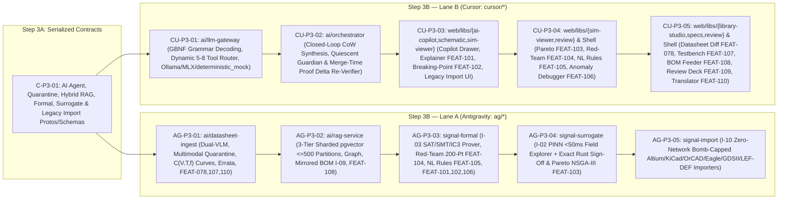

# Phase 3 Plan — Neuro-Symbolic AI Agents, Multimodal Zero-Tool Quarantine, Condition-Parameterized Datasheet RAG & Supply Chain

> **Phase Goal:** Build Signal's Neuro-Symbolic AI Agent stack (`ai/datasheet-ingest`, `ai/rag-service`, `ai/llm-gateway`, `ai/orchestrator`), Multimodal VLM + Dual-LLM Zero-Tool Quarantine (`F-090`, `F-131`), Condition-Parameterized Universal Datasheet DB (`C(V,T,f)`, silicon errata, `F-063`, `F-132`), 3-Tier Sharded `pgvector` HNSW Hybrid RAG (`<= 500` partitions, `F-086`, `F-130`), Privacy-Preserving Mirrored Multi-Distributor BOM Rescue (`I-09`, `F-146`), `signal-formal` (`I-03`), `signal-surrogate` (`I-02`), Clean-Room Legacy CAD Importers (`signal-import` `I-10`), and all 11 AI & Datasheet UX Features (`FEAT-078`, `FEAT-101`–`FEAT-110`).  
> **Governing Specs:** [`05`](../architecture/05-ai-agent-and-datasheet-rag.md), [`15`](../architecture/15-application-security-and-project-isolation.md), [`16`](../architecture/16-architectural-audit-flaws-and-futuristic-innovations.md), [`17`](../architecture/17-extended-feature-specifications-ui-and-rust.md), [`18`](../architecture/18-universal-component-and-datasheet-repository.md)  
> **Ledgers to Tick:** [`TODO-LEDGER-SHARED-CONTRACTS.md`](./TODO-LEDGER-SHARED-CONTRACTS.md) • [`TODO-LEDGER-ANTIGRAVITY-LANE-A.md`](./TODO-LEDGER-ANTIGRAVITY-LANE-A.md) • [`TODO-LEDGER-CURSOR-LANE-B.md`](./TODO-LEDGER-CURSOR-LANE-B.md)

---

## 1. Execution Wave Order

---

## 2. Step 3A — Serialized Contract Freeze (`contracts/**` ONLY)

### `C-P3-01` — AI Agent, Quarantine AST, Hybrid RAG, Formal Verification (`I-03`), PINN Surrogate (`I-02`) & Legacy Import (`I-10`) Contracts
- **Branch:** `contract/C-P3-01-ai-rag-formal-import-protos` | **Touched Paths:** `contracts/proto/signal/v1/**`, `contracts/schemas/datasheet-record.schema.json`, `contracts/fixtures/ai_rag_*.json`
- **Skills:** `signal-contract-first`, `signal-ai-neuro-symbolic-rag`, `signal-verification-and-pr-gate`
- **Deliverables:** Finalize Protobuf RPCs & `datasheet-record.schema.json` for `ConditionCurveSet` (`C(V,T,f)`, `L(I,T)`, copper-coupled $R_{\theta JC}/R_{\theta JB}$), `ProofBundle`, `FormalEquivalenceReport`, `ParetoCandidate`, `CleanRoomImportReport`, and `FEAT-078`, `FEAT-101`–`FEAT-110`.
- **Verify & Tick:** `./signal.sh check --target contracts` → Tick `C-P3-01` in [`TODO-LEDGER-SHARED-CONTRACTS.md`](./TODO-LEDGER-SHARED-CONTRACTS.md).

---

## 3. Step 3B — Lane A: Antigravity Parallel Tasks (`ag/*`)

### `AG-P3-01` — `ai/datasheet-ingest`: Dual-VLM Consensus, Multimodal Zero-Tool Quarantine, Condition Curves & Errata (`FEAT-078`, `107`, `110`)
- **Branch:** `ag/AG-P3-01-datasheet-ingest` | **Touched Paths:** `ai/datasheet-ingest/**`
- **Skills:** `signal-ai-neuro-symbolic-rag`, `signal-universal-parts-registry`, `signal-security-isolation-audit`
- **Deliverables:**
  1. **Multimodal VLM + Dual-LLM Zero-Tool Quarantine (`F-090`, `F-131`):** All PDFs, OCR text, and whiteboard images pass through a zero-tool `QuarantineReader` (image rescaling/contrast normalization + `GBNF` schema-locked AST extraction) — raw untrusted text/pixels NEVER enter a tool-calling agent context.
  2. **Dual-VLM Consensus + Condition-Parameterized Curve Extractor (`F-052`, `F-063`, `F-132`):** Extracts full derating polynomials (`mlcc_dc_bias_c_ratio`, `inductor_isat_l_ratio`, $R_{DS(on)}(T_j, V_{GS})$, SOA boundaries, copper-area $R_{\theta JA}(\text{mm}^2)$) + links Silicon Errata & PCN/PDN bulletins.
  3. Kernels for **`FEAT-078`** (`revision_diff` Rev A → Rev B table/pin/curve diff), **`FEAT-107`** (`ref_circuit` Typical-Application diagram reconstructor & SPICE testbench builder), and **`FEAT-110`** (quarantined multi-language technical glossary translator preserving `RefDes`/`NetName`/SI literals).
- **Verify & Tick:** `./signal.sh check --target ai` → Tick `AG-P3-01` in [`TODO-LEDGER-ANTIGRAVITY-LANE-A.md`](./TODO-LEDGER-ANTIGRAVITY-LANE-A.md).

### `AG-P3-02` — `ai/rag-service`: 3-Tier Sharded `pgvector` HNSW (`<= 500` Partitions), Graph RAG & Mirrored BOM Rescue (`I-09`, `FEAT-108`)
- **Branch:** `ag/AG-P3-02-rag-service` | **Touched Paths:** `ai/rag-service/**`
- **Skills:** `signal-ai-neuro-symbolic-rag`, `signal-security-isolation-audit`, `signal-verification-and-pr-gate`
- **Deliverables:**
  1. **3-Tier Sharded `pgvector` Architecture (`F-086`, `F-130`):** Tier 1 `datasheet_chunks_global`, Tier 2 `64` fixed hash-bucketed multi-org partitions (`org_hash_00`..`63` with `NOBYPASSRLS` + `hnsw.iterative_scan = 'relaxed_order'`), and Tier 3 Dedicated Sovereign Single-Tenant DBs (`<= 500` partitions per Postgres `19+` cluster!).
  2. Tri-modal Hybrid Retrieval (`0.45 * Parametric SQL + 0.35 * Dense Vector + 0.20 * BM25` + Cross-Encoder Reranker + Page/Table provenance citations).
  3. **Mirrored Multi-Distributor BOM & Padded Batch Query Engine (`I-09`, `F-061`, `F-146`):** Queries Signal's in-cluster mirrored catalog (DigiKey/Mouser/Arrow/LCSC/Avnet) or pads fallback external lookups to fixed `k=256` shuffled batches + **`FEAT-108`** (`bom_consolidator` greedy set-cover SMT feeder-slot minimizer).
- **Verify & Tick:** `./signal.sh check --target ai` → Tick `AG-P3-02` in [`TODO-LEDGER-ANTIGRAVITY-LANE-A.md`](./TODO-LEDGER-ANTIGRAVITY-LANE-A.md).

### `AG-P3-03` — `signal-formal` (`I-03`): SAT/SMT/IC3 Formal Prover, 200-Point Red-Team (`FEAT-104`), NL Constraint Compiler (`FEAT-105`) & Circuit Explainer/Debugger (`FEAT-101`, `102`, `106`)
- **Branch:** `ag/AG-P3-03-signal-formal-and-ai-kernels` | **Touched Paths:** `engine/crates/signal-formal/**`, `engine/crates/signal-graph/src/subgraph_matcher.rs`, `engine/crates/signal-diff-sim/src/stress_boundary.rs`, `engine/crates/signal-sim/src/anomaly_attribution.rs`
- **Skills:** `signal-rust-physics-and-geometry`, `signal-ai-neuro-symbolic-rag`, `signal-verification-and-pr-gate`
- **Deliverables:**
  1. `signal-formal` (`I-03`, `F-035`): Built-in SAT/SMT/BDD + IC3/PDR engine proving RTL-to-Gate logical equivalence, FSM deadlock/livelock freedom, CDC/RDC safety, and power-rail sequencing invariants.
  2. **`FEAT-101`** (`signal-graph::subgraph_matcher` VF2 isomorphism & symbolic small-signal transfer function extractor), **`FEAT-102`** (`signal-diff-sim::stress_boundary` worst-case vector solver to SOA/timing failure), **`FEAT-104`** (`signal-formal::redteam_deck` 200-point deterministic Pre-Fab/Pre-Tapeout heuristic auditor), **`FEAT-105`** (`signal-formal::constraint_ast` deterministic DRC/UPF/SDC/SVA validator), and **`FEAT-106`** (`signal-sim::anomaly_attribution` loop-gain/pole-zero/parasitic root-cause ranker).
- **Verify & Tick:** `./signal.sh check --target rust-pod` → Tick `AG-P3-03` in [`TODO-LEDGER-ANTIGRAVITY-LANE-A.md`](./TODO-LEDGER-ANTIGRAVITY-LANE-A.md).

### `AG-P3-04` — `signal-surrogate` (`I-02`): GPU PINN Fast-Explore Operators + Exact Rust Sign-Off & Pareto NSGA-III (`FEAT-103`)
- **Branch:** `ag/AG-P3-04-signal-surrogate-and-pareto` | **Touched Paths:** `engine/crates/signal-surrogate/**`, `engine/crates/signal-diff-sim/src/pareto_nsga3.rs`
- **Skills:** `signal-rust-physics-and-geometry`, `signal-ai-neuro-symbolic-rag`, `signal-verification-and-pr-gate`
- **Deliverables:**
  1. `signal-surrogate` (`I-02`, `F-059`): Fourier Neural Operator (FNO) / Graph Neural Operator (GNO) delivering `< 50 ms` interactive 3D EM/thermal/IR-drop previews during drag, **automatically verified by exact Rust MNA/FEM sign-off** before any commit or SFTP release.
  2. **`FEAT-103`** (`signal-diff-sim::pareto_nsga3`: Multi-objective NSGA-III + Saltation-Adjoint optimizer across BOM Cost \$, Efficiency %, PCB Area $\text{mm}^2$, Peak $T_j$, and Embodied Carbon $\text{kgCO}_2\text{e}$).
- **Verify & Tick:** `./signal.sh check --target rust-pod` → Tick `AG-P3-04` in [`TODO-LEDGER-ANTIGRAVITY-LANE-A.md`](./TODO-LEDGER-ANTIGRAVITY-LANE-A.md).

### `AG-P3-05` — `signal-import` (`I-10`): Zero-Network Bomb-Capped Clean-Room Legacy CAD Importers
- **Branch:** `ag/AG-P3-05-signal-import` | **Touched Paths:** `engine/crates/signal-import/**`
- **Skills:** `signal-rust-crate-architect`, `signal-security-isolation-audit`, `signal-verification-and-pr-gate`
- **Deliverables:**
  1. Ephemeral zero-network WASM/MicroVM parsers (`I-10`, `F-062`, `F-085`) for **Altium (`.SchDoc`/`.PcbDoc`), KiCad (`v6–v9`), Cadence OrCAD/Allegro, Eagle, LTspice (`.asc`), GDSII/OASIS, and LEF/DEF** with strict decompression ratio caps (`<= 20:1`), max hierarchy depth (`<= 64`), XML DTD/XXE hard-disable, and automated netlist-vs-source equivalence report.
- **Verify & Tick:** `./signal.sh check --target rust-pod` → Tick `AG-P3-05` in [`TODO-LEDGER-ANTIGRAVITY-LANE-A.md`](./TODO-LEDGER-ANTIGRAVITY-LANE-A.md).

---

## 4. Step 3B — Lane B: Cursor Parallel Tasks (`cursor/*`)

### `CU-P3-01` — `ai/llm-gateway`: `GBNF` Grammar-Constrained Router, Dynamic 5–8 Tool Subset & Local Ollama/MLX/`deterministic_mock`
- **Branch:** `cursor/CU-P3-01-llm-gateway` | **Touched Paths:** `ai/llm-gateway/**`
- **Skills:** `signal-ai-neuro-symbolic-rag`, `signal-local-mac-dev`, `signal-fastapi-control-plane`
- **Deliverables:**
  1. Unified LLM gateway defaulting to local macOS **Ollama / Apple MLX** (`SIGNAL_ENV=local`) with automatic offline fallback to **`deterministic_mock`** (`F-143`) and enterprise cloud/self-hosted vLLM in production.
  2. **Grammar-Constrained Decoding (`GBNF` / JSON-Schema) + Dynamic 5–8 Tool Subset Routing** (`F-054`: zero malformed JSON even on 7B local models) + per-user/org token & GPU budget circuit-breakers (`F-098`).
- **Verify & Tick:** `./signal.sh check --target ai` → Tick `CU-P3-01` in [`TODO-LEDGER-CURSOR-LANE-B.md`](./TODO-LEDGER-CURSOR-LANE-B.md).

### `CU-P3-02` — `ai/orchestrator`: Closed-Loop CoW Speculative Synthesis, Quiescent Guardian & Merge-Time Proof Delta Re-Verifier
- **Branch:** `cursor/CU-P3-02-ai-orchestrator` | **Touched Paths:** `ai/orchestrator/**`
- **Skills:** `signal-ai-neuro-symbolic-rag`, `signal-security-isolation-audit`, `signal-verification-and-pr-gate`
- **Deliverables:**
  1. Neuro-symbolic agent loop (`Spec -> RAG -> CoW Branch GraphOp -> Rust SPICE/DRC/Formal Verification -> Signed ProofBundle`, `F-044`, `F-053`).
  2. **Quiescent-Idle & Commit-Boundary Design Guardian** (zero mid-drag alert spam, `F-065`) + **Merge-Time Proof Delta Re-Verification Gate** (`F-133`: detects if `main` moved since branch creation and re-runs fast incremental Rust MNA/DRC/Formal proof before applying AI proposal).
- **Verify & Tick:** `./signal.sh check --target ai` → Tick `CU-P3-02` in [`TODO-LEDGER-CURSOR-LANE-B.md`](./TODO-LEDGER-CURSOR-LANE-B.md).

### `CU-P3-03` — `web/libs/{ai-copilot,schematic,sim-viewer}`: Copilot Drawer, Circuit Explainer (`FEAT-101`), Breaking-Point Explorer (`FEAT-102`) & Clean-Room Import Wizard
- **Branch:** `cursor/CU-P3-03-ai-copilot-and-explainer-ui` | **Touched Paths:** `web/libs/ai-copilot/**`, `web/libs/schematic/src/lib/circuit-explainer/**`, `web/libs/sim-viewer/src/lib/breaking-point/**`
- **Skills:** `signal-angular-workbench`, `signal-angular-ui-style-system`, `signal-ai-neuro-symbolic-rag`
- **Deliverables:**
  1. `web/libs/ai-copilot`: Speculative CoW diff previewer, Formal Proof Certificate card, Clean-Room Legacy CAD & Whiteboard upload wizard (`I-10`).
  2. **`FEAT-101`** (`CircuitExplainerOverlay`: functional stage bounding boxes, signal-flow arrows, live transfer-function math cards) and **`FEAT-102`** (`BreakingPointExplorerPanel`: radar/tornado envelope stress explorer showing the exact component that hits SOA/timing breakdown first).
- **Verify & Tick:** `./signal.sh check --target ui` → Tick `CU-P3-03` in [`TODO-LEDGER-CURSOR-LANE-B.md`](./TODO-LEDGER-CURSOR-LANE-B.md).

### `CU-P3-04` — `web/libs/{sim-viewer,review}` & Shell: Pareto Explorer (`FEAT-103`), 200-Pt Red-Team (`FEAT-104`), NL Rule Compiler (`FEAT-105`) & Anomaly Debugger (`FEAT-106`)
- **Branch:** `cursor/CU-P3-04-pareto-redteam-nlrules-anomaly-ui` | **Touched Paths:** `web/libs/sim-viewer/src/lib/{pareto-frontier,anomaly-debugger}/**`, `web/libs/review/src/lib/principal-audit/**`, `web/apps/signal-web/src/app/nl-constraint-composer/**`
- **Skills:** `signal-angular-workbench`, `signal-angular-ui-style-system`, `signal-ai-neuro-symbolic-rag`
- **Deliverables:**
  1. **`FEAT-103`** (`ParetoFrontierStudioComponent`: 3D/parallel-coordinates Cost vs. Efficiency vs. Area vs. Carbon explorer with 1-click CoW branch preview), **`FEAT-104`** (`PrincipalAuditReportDrawer`: 200-point Red-Team report with 1-click canvas jump & auto-fix), **`FEAT-105`** (`NlConstraintComposerModal`: side-by-side NL prompt → compiled DRC/UPF/SDC/SVA diff), and **`FEAT-106`** (`AnomalyRootCausePopover`: ringing/overshoot/droop root-cause ranked fixes).
- **Verify & Tick:** `./signal.sh check --target ui` → Tick `CU-P3-04` in [`TODO-LEDGER-CURSOR-LANE-B.md`](./TODO-LEDGER-CURSOR-LANE-B.md).

### `CU-P3-05` — `web/libs/{library-studio,specs,review}` & Shell: Datasheet Diff (`FEAT-078`), Testbench Wizard (`FEAT-107`), BOM Consolidator (`FEAT-108`), Review Deck (`FEAT-109`) & Translator (`FEAT-110`)
- **Branch:** `cursor/CU-P3-05-datasheet-bom-review-translator-ui` | **Touched Paths:** `web/libs/specs/src/lib/{datasheet-drift,bom-consolidation}/**`, `web/libs/library-studio/src/lib/datasheet-testbench/**`, `web/libs/review/src/lib/live-review-deck/**`, `web/apps/signal-web/src/app/inline-translate/**`
- **Skills:** `signal-angular-workbench`, `signal-angular-ui-style-system`, `signal-universal-parts-registry`
- **Deliverables:**
  1. **`FEAT-078`** (`DatasheetDriftNotificationDrawer`), **`FEAT-107`** (`DatasheetTestbenchWizard`: PDF upload → Typical Application schematic + SPICE testbench vs. datasheet reference overlay), **`FEAT-108`** (`BomConsolidationDrawer`: safe passive/package feeder-slot consolidation with Saltation-Adjoint zero-shift verification), **`FEAT-109`** (`LiveReviewDeckComponent`: in-app zero-export interactive CDR/PDR/FDR presentation mode), and **`FEAT-110`** (`InlineTranslateToggle`: quarantined 15+ language hover/side-by-side translation).
- **Verify & Tick:** `./signal.sh check --target ui` → Tick `CU-P3-05` in [`TODO-LEDGER-CURSOR-LANE-B.md`](./TODO-LEDGER-CURSOR-LANE-B.md).
