# Phase 4 Plan — Full PCB Layout/Routing, 224G SI/PI/3D-EM, Magnetics/Power/EMC/Safety, Zero-Leak Stream & 2FA SFTP Release

> **Phase Goal:** Implement Signal's full high-speed PCB layout & push-and-shove router (`signal-pcb`, `FEAT-011`–`019`, `095`, `096`), GPU 3D Full-Wave EM & 224G PAM4 SerDes solver (`signal-em3d` `I-04`, `FEAT-087`, `089`), Custom Magnetics & Power Integrity Studio (`signal-magnetics`, `signal-power-integrity`, `FEAT-021`–`030`), EMC/ESD/FMEDA/FTA/WCCA/Rad-Hard & 15-Year Aging (`signal-emc`, `signal-aging` `I-05`, `FEAT-031`–`040`), DFM/Panelization/DFA/Solder-Fatigue/Should-Cost (`signal-dfm`, `FEAT-063`–`069`, `080`), Enterprise Zero-Leak Tardos + Topological/Geometric Constellation Watermark Streaming (`07-*`), and Step-Up 2FA Disposable Write-Only `russh` SFTP Release (`signal-sftp-egress`, `services/sftp-egress`, `web/libs/sftp-release`).  
> **Governing Specs:** [`01`](../architecture/01-product-vision-and-features.md), [`03`](../architecture/03-rust-eda-engine.md), [`06`](../architecture/06-frontend-angular-and-fastapi-control-plane.md), [`07`](../architecture/07-security-encryption-dlp-and-sftp.md), [`15`](../architecture/15-application-security-and-project-isolation.md), [`16`](../architecture/16-architectural-audit-flaws-and-futuristic-innovations.md), [`17`](../architecture/17-extended-feature-specifications-ui-and-rust.md)  
> **Ledgers to Tick:** [`TODO-LEDGER-SHARED-CONTRACTS.md`](./TODO-LEDGER-SHARED-CONTRACTS.md) • [`TODO-LEDGER-ANTIGRAVITY-LANE-A.md`](./TODO-LEDGER-ANTIGRAVITY-LANE-A.md) • [`TODO-LEDGER-CURSOR-LANE-B.md`](./TODO-LEDGER-CURSOR-LANE-B.md)

---

## 1. Execution Wave Order

```mermaid
flowchart LR
    subgraph Step4A["Step 4A: Serialized Contracts"]
        CP401["C-P4-01: PCB, 224G 3D-EM, Magnetics, Power Integrity, EMC, Safety & Aging Protos"] --> CP402["C-P4-02: DFM, Panelization, Zero-Leak Watermark & Step-Up 2FA SFTP Release Protos"]
    end
    subgraph Step4B_AG["Step 4B — Lane A (Antigravity: ag/*)"]
        AG401["AG-P4-01: signal-pcb (PNS Router, Bus-Trunk, Meanders, Fiber-Weave, Pour, Pkg Delay, HDI, Fab Profiles, PCB ECO FEAT-011..018,095)"]
        AG402["AG-P4-02: signal-em3d (I-04 GPU 3D PEEC/FDTD/FEM, 224G PAM4, Via Stub, Return Path, RF Synth, 3D Fields & TDR FEAT-013,016,019,087,089)"]
        AG403["AG-P4-03: signal-magnetics & signal-power-integrity (Magnetics, PDN, 3D Creepage, Busbar IR, Hot-Loop, Bode, BMS, FOC, Thermal, Seq FEAT-021..030)"]
        AG404["AG-P4-04: signal-emc & signal-aging (I-05 CISPR/FCC, EMI Filter, ESD/Surge, Shield, Piezo, FMEDA, FTA, WCCA, Rad-Hard, Derating FEAT-031..040)"]
        AG405["AG-P4-05: signal-dfm (Panelizer, DFA, Solder Fatigue, Coating, GD&T Drawings, Should-Cost, ICT Testpoints, MSL Reflow FEAT-063..069,080)"]
        AG406["AG-P4-06: signal-pod Zero-Leak DLP Engine (Tardos + Topological Constellation Watermarks, X-Ray Mask FEAT-096, Gerber/ODB++/IPC-2581)"]
        AG407["AG-P4-07: signal-sftp-egress (Ephemeral Write-Only russh Pod, Socket-Pinned IP, Atomic .tmp.part -> SHA-256 -> rename + ML-DSA .sig)"]
        AG401 --> AG402 --> AG403 --> AG404 --> AG405 --> AG406 --> AG407
    end
    subgraph Step4B_CU["Step 4B — Lane B (Cursor: cursor/*)"]
        CU401["CU-P4-01: web/libs/pcb (PCB Workbench, PNS Router, Constraint Grid, Fiber-Weave, Meanders, RF, 3D EM Fields, TDR, X-Ray FEAT-011..019,087,089,095,096)"]
        CU402["CU-P4-02: web/libs/{magnetics,power-studio} (Magnetics FEAT-021, PDN, 3D Creepage, IR-Drop, Hot-Loop, Bode, BMS, FOC, Thermal, Seq FEAT-022..030)"]
        CU403["CU-P4-03: web/libs/{emc-lab,safety-wcca} (CISPR Spectrum, EMI Filter, ESD/Surge, Shield, Piezo, FMEDA, FTA, WCCA, Rad-Hard, Derating FEAT-031..040)"]
        CU404["CU-P4-04: web/libs/dfm-panel (Panel Composer, DFA, Fatigue, Coating, GD&T Sheets, Should-Cost Pill, ICT Heatmap, MSL FEAT-063..069,080)"]
        CU405["CU-P4-05: services/sftp-egress & web/libs/sftp-release (Step-Up 2FA WebAuthn/Redis-Burned TOTP, Atomic SFTP Push & Lab/Partner Egress)"]
        CU406["CU-P4-06: web/libs/canvas-core Zero-Leak DLP Guardrails (Attested Browser Capture Lock, Rate-Limit Anomaly Freeze, Print/Clipboard Block)"]
        CU401 --> CU402 --> CU403 --> CU404 --> CU405 --> CU406
    end
    CP402 --> AG401
    CP402 --> CU401
```

---

## 2. Step 4A — Serialized Contract Freeze (`contracts/**` ONLY)

### `C-P4-01` — High-Speed PCB, 3D EM (`I-04`), Magnetics, Power Integrity, EMC, Functional Safety & Aging (`I-05`) Contracts
- **Branch:** `contract/C-P4-01-pcb-em-power-emc-protos` | **Touched Paths:** `contracts/proto/signal/v1/**`, `contracts/schemas/fab-capability-profile.schema.json`
- **Skills:** `signal-contract-first`, `signal-verification-and-pr-gate`
- **Deliverables:** Finalize Protobuf RPCs (`bigint` SI units `_nm`, `_ps`, `_uv`, `_hz`) & `fab-capability-profile.schema.json` (`F-135`) for `FEAT-011`–`FEAT-040`, `FEAT-087`, `FEAT-089`, `FEAT-095`, `FEAT-096`, `I-04`, `I-05`.
- **Verify & Tick:** `./signal.sh check --target contracts` → Tick `C-P4-01` in [`TODO-LEDGER-SHARED-CONTRACTS.md`](./TODO-LEDGER-SHARED-CONTRACTS.md).

### `C-P4-02` — DFM, Panelization, Zero-Leak Watermark & Step-Up 2FA SFTP Release Contracts
- **Branch:** `contract/C-P4-02-dfm-and-sftp-protos` | **Touched Paths:** `contracts/proto/signal/v1/sftp_release.proto`, `contracts/schemas/sftp-release-manifest.schema.json`, `contracts/transcripts/sftp_stepup_2fa_release.jsonl`
- **Skills:** `signal-contract-first`, `signal-security-isolation-audit`, `signal-verification-and-pr-gate`
- **Deliverables:** Finalize `sftp_release.proto`, `sftp-release-manifest.schema.json`, and `FEAT-063`–`FEAT-069`, `FEAT-080` contracts.
- **Verify & Tick:** `./signal.sh check --target contracts` → Tick `C-P4-02` in [`TODO-LEDGER-SHARED-CONTRACTS.md`](./TODO-LEDGER-SHARED-CONTRACTS.md).

---

## 3. Step 4B — Lane A: Antigravity Parallel Tasks (`ag/*`)

### `AG-P4-01` — `signal-pcb`: PNS Router, Bus-Trunk, Diff-Pair Meanders, Fiber-Weave, Copper Hygiene, Package Delay, HDI, Fab Profiles & PCB ECO (`FEAT-011`, `012`, `014`, `015`, `017`, `018`, `095`)
- **Branch:** `ag/AG-P4-01-signal-pcb-engine` | **Touched Paths:** `engine/crates/signal-pcb/**`, `engine/crates/signal-graph/src/constraint_matrix.rs`
- **Skills:** `signal-rust-physics-and-geometry`, `signal-rust-crate-architect`, `signal-verification-and-pr-gate`
- **Deliverables:**
  1. Interactive obstacle-avoiding Push-and-Shove (PNS) router, **`FEAT-017`** (`bus_pns` 8–64 trace bundled trunk router), **`FEAT-012`** (`meander_tuner` `5x W` coupled-arc trombone phase matching), **`FEAT-011`** (`fiber_weave` spatially periodic $\varepsilon_r(x,y)$ glass-weave skew & `10 deg` rotation solver), **`FEAT-014`** (`copper_hygiene` Clipper2/Minkowski island/acid-trap/teardrop solver), **`FEAT-015`** (`pkg_flight_time` die-to-ball + PCB delay sum), **`FEAT-018`** (`hdi_stackup` IPC-2226 microvia aspect-ratio & $N\times$ reflow strain check), and **`FEAT-095`** (`constraint_matrix` bulk net-class rule matrix).
  2. **Vendor-Parameterized Fab Capability Profiles** (JLCPCB, PCBWay, Eurocircuits, Sierra, TTM, OshPark `.fabprofile.json`, `F-135`) + **Minimal-Perturbation PCB ECO Rip-Up & Re-Route** (`F-134`).
- **Verify & Tick:** `./signal.sh check --target rust-pod` → Tick `AG-P4-01` in [`TODO-LEDGER-ANTIGRAVITY-LANE-A.md`](./TODO-LEDGER-ANTIGRAVITY-LANE-A.md).

### `AG-P4-02` — `signal-em3d` (`I-04`): GPU 3D Full-Wave EM, 224G PAM4 SerDes, Via Back-Drill (`FEAT-013`), Return-Path (`FEAT-016`), RF Synth (`FEAT-019`), 3D Field Animator (`FEAT-087`) & TDR Peeling (`FEAT-089`)
- **Branch:** `ag/AG-P4-02-signal-em3d` | **Touched Paths:** `engine/crates/signal-em3d/**`, `benchmarks/em3d/**`
- **Skills:** `signal-rust-physics-and-geometry`, `signal-verification-and-pr-gate`
- **Deliverables:**
  1. GPU-accelerated 3D PEEC / FDTD / FEM solver (`I-04`, `F-036`) + causal passive S-parameter **Vector Fitting** (enforcing $\mathbb{I} - S^H(j\omega)S(j\omega) \succeq 0$, `F-032`) + 112G/224G PAM4 SerDes Channel Operating Margin (COM) & FFE/CTLE/DFE analyzer.
  2. **`FEAT-013`** (`via_stub` Quarter-wave $f_{\text{notch}} \approx c / (4 \cdot L_{\text{stub}} \sqrt{\varepsilon_{\text{eff}}})$ back-drill optimizer), **`FEAT-016`** (`return_path` image-current detour loop inductance $\Delta L$), **`FEAT-019`** (`rf_synth` microstrip/Wilkinson/branchline/hairpin/patch antenna closed-form + Euler geometry), **`FEAT-087`** (`field_stream` $\vec{E}$/$\vec{H}$/$\vec{J}_s$ & 3D antenna radiation gain patterns), and **`FEAT-089`** (`tdr_peeling` IFFT layer-peeling $Z_0(d)$ vs. physical `(x_nm, y_nm, layer)` distance mapper).
- **Verify & Tick:** `./signal.sh check --target rust-pod` → Tick `AG-P4-02` in [`TODO-LEDGER-ANTIGRAVITY-LANE-A.md`](./TODO-LEDGER-ANTIGRAVITY-LANE-A.md).

### `AG-P4-03` — `signal-magnetics` & `signal-power-integrity`: Custom Magnetics, PDN, 3D Geodesic Creepage, Busbar IR-Drop, Hot-Loop, Bode, BMS, FOC Motor, Thermal CFD & Sequencing (`FEAT-021`–`FEAT-030`)
- **Branch:** `ag/AG-P4-03-magnetics-and-power-integrity` | **Touched Paths:** `engine/crates/{signal-magnetics,signal-power-integrity}/**`
- **Skills:** `signal-rust-physics-and-geometry`, `signal-verification-and-pr-gate`
- **Deliverables:**
  1. **`FEAT-021`** (`signal-magnetics`: Steinmetz/iGSE core loss, Dowell skin/proximity AC winding loss, 2D axisymmetric FEA fringing/leakage $L_{lk}$, Gerber planar coil generator).
  2. `signal-power-integrity`: **`FEAT-022`** (`pdn` 2.5D plane-cavity $Z_{\text{PDN}}(f) \le Z_{\text{target}}(f)$ MLCC placer), **`FEAT-023`** (`creepage_3d` Mitchell-Mount-Papadimitriou exact 3D surface geodesic shortest path across slots/ribs per IEC 60664-1 / UL 62368-1 / IEC 60601-1), **`FEAT-024`** (`dc_ir` FEM $\nabla \cdot (\sigma(T)\nabla V) = 0$ + Joule heating), **`FEAT-025`** (`hot_loop` PEEC $L_{\text{loop}}$ & SiC/GaN $C_{gd} dV/dt$ Miller shoot-through), **`FEAT-026`** (`loop_comp` Type-II/Type-III & digital PID $z$-domain $K$-factor synthesizer), **`FEAT-027`** (`battery_bms` 2-RC Randles $N\text{S}M\text{P}$ pack + Arrhenius thermal runaway), **`FEAT-028`** (`motor_drive` Park/Clarke $dq0$ PMSM/BLDC FOC + SVPWM), **`FEAT-029`** (`thermal_cfd` heatsink/CFM airflow/TIM/cold-plate solver), and **`FEAT-030`** (`sequencing` multi-rail ramp/inrush/body-diode back-powering verifier).
- **Verify & Tick:** `./signal.sh check --target rust-pod` → Tick `AG-P4-03` in [`TODO-LEDGER-ANTIGRAVITY-LANE-A.md`](./TODO-LEDGER-ANTIGRAVITY-LANE-A.md).

### `AG-P4-04` — `signal-emc` & `signal-aging` (`I-05`): CISPR/FCC Pre-Compliance, EMI Filter, ESD/Surge, Shield, Piezo, FMEDA, FTA, WCCA, Rad-Hard, Derating (`FEAT-031`–`040`) & 15-Yr Aging
- **Branch:** `ag/AG-P4-04-signal-emc-and-aging` | **Touched Paths:** `engine/crates/{signal-emc,signal-aging}/**`
- **Skills:** `signal-rust-physics-and-geometry`, `signal-verification-and-pr-gate`
- **Deliverables:**
  1. `signal-emc`: **`FEAT-031`** (`precompliance` `50 Ohm / 50 uH` LISN DM/CM conducted + 3m/10m dipole radiated emissions vs. CISPR 11/25/32, FCC Part 15, MIL-STD-461), **`FEAT-032`** (`filter_synth` CM/DM choke + X/Y-cap + Middlebrook $\|Z_{\text{out}}(j\omega)\| \ll \|Z_{\text{in}}(j\omega)\|$ stability), **`FEAT-033`** (`transient_immunity` IEC 61000-4-2 8kV/15kV ESD, -4-4 EFT, -4-5 / DO-160 Surge TVS clamping), **`FEAT-034`** (`shield_cavity` cavity modes $f_{mnp}$ & slot leakage), **`FEAT-035`** (`fmeda` ISO 26262 / IEC 61508 automated fault-injection SPFM/LFM/PMHF calculator), **`FEAT-036`** (`fta_bdd` Zero-Suppressed BDD minimal cut-sets), **`FEAT-037`** (`wcca` Extreme Value Analysis, RSS, Saltation-Adjoint worst-case corner), **`FEAT-038`** (`rad_hard` Double-Exponentialmessenger LET heavy-ion SET/SEU injector), **`FEAT-039`** (`piezo_acoustic` MLCC 20 Hz–20 kHz ripple & magnetostriction), and **`FEAT-040`** (`derating_rules` ECSS-Q-ST-30-11 / NAVSEA / Enterprise stress auditor).
  2. `signal-aging` (`I-05`): 10–15 year mission-profile reliability degradation solver (MOSFET NBTI/PBTI/HCI/TDDB, Black's Law interconnect electromigration, capacitor ESR/capacitance drift, Norris-Landzberg solder fatigue).
- **Verify & Tick:** `./signal.sh check --target rust-pod` → Tick `AG-P4-04` in [`TODO-LEDGER-ANTIGRAVITY-LANE-A.md`](./TODO-LEDGER-ANTIGRAVITY-LANE-A.md).

### `AG-P4-05` — `signal-dfm`: Panelization, DFA, Solder Fatigue, Coating Keepouts, Live GD&T Drawings, Should-Cost, ICT Testpoints & MSL Reflow (`FEAT-063`–`069`, `080`)
- **Branch:** `ag/AG-P4-05-signal-dfm` | **Touched Paths:** `engine/crates/signal-dfm/**`
- **Skills:** `signal-rust-physics-and-geometry`, `signal-verification-and-pr-gate`
- **Deliverables:**
  1. **`FEAT-063`** (`panelizer` step-and-repeat, mouse-bite tabs, V-score & depaneling bending-strain MLCC flex-crack guard), **`FEAT-064`** (`dfa_solder` IPC-7351B component spacing, reflow shadowing, tombstone thermal balance, stencil area ratio $> 0.66$), **`FEAT-065`** (`mechanics_fatigue` Coffin-Manson/Engelmaier BGA/QFN cycles-to-failure & Steinberg board modal resonances), **`FEAT-066`** (`coating_keepout` boolean conformal-coating/selective-solder mask layers), **`FEAT-067`** (`drawing_gen` deterministic SVG/PDF fabrication & assembly drawings with drill tables & GD&T), **`FEAT-068`** (`should_cost` live PCB + BOM + SMT cost/yield estimator), **`FEAT-069`** (`testpoint_opt` ICT / flying-probe & IEEE 1149.1 JTAG coverage optimizer `I-08`), and **`FEAT-080`** (`msl_reflow` J-STD-020 peak temperature & floor-life tracker).
- **Verify & Tick:** `./signal.sh check --target rust-pod` → Tick `AG-P4-05` in [`TODO-LEDGER-ANTIGRAVITY-LANE-A.md`](./TODO-LEDGER-ANTIGRAVITY-LANE-A.md).

### `AG-P4-06` — `signal-pod` Zero-Leak DLP Watermark Engine, X-Ray Mask (`FEAT-096`) & Manufacturing Writers (Gerber X3/ODB++/IPC-2581)
- **Branch:** `ag/AG-P4-06-zero-leak-watermarks-and-gerber` | **Touched Paths:** `engine/crates/signal-pod/src/{watermark,render_mask,fab_writers}/**`
- **Skills:** `signal-zero-leak-canvas-and-dlp`, `signal-security-isolation-audit`, `signal-rust-physics-and-geometry`
- **Deliverables:**
  1. **Dual-Layer Forensic Watermarking (`F-080`, `F-128`):** (a) **Tardos-Code Collusion-Resistant Spread-Spectrum Pixel Steganography** + (b) **AI-Resilient Topological & Geometric Constellation Watermarking** ($\pm 1\text{–}3\text{ px}$ label kerning, silkscreen tick marks, sub-pixel via/chamfer phase coding keyed by `HMAC(session_seed, tile_id)` surviving AI image-to-image diffusion & vector tracing!).
  2. **`FEAT-096`** (`render_mask` GPU uniform bitmask for 0-cost single-key X-Ray net isolation) + in-memory manufacturing stream writers (Gerber X2/X3, Excellon, ODB++, IPC-2581 Rev C — streamed directly into `signal-sftp-egress` RAM, zero browser download!).
- **Verify & Tick:** `./signal.sh check --target rust-pod` → Tick `AG-P4-06` in [`TODO-LEDGER-ANTIGRAVITY-LANE-A.md`](./TODO-LEDGER-ANTIGRAVITY-LANE-A.md).

### `AG-P4-07` — `signal-sftp-egress`: Disposable Write-Only `russh` SFTP Pod & Atomic `.tmp.part` → SHA-256 → `rename` Protocol
- **Branch:** `ag/AG-P4-07-signal-sftp-egress-rust` | **Touched Paths:** `engine/crates/signal-sftp-egress/**`
- **Skills:** `signal-security-isolation-audit`, `signal-rust-crate-architect`, `signal-verification-and-pr-gate`
- **Deliverables:**
  1. Ephemeral one-shot memory-safe Rust SSH2 (`russh`) pod (`F-081`, `F-082`, `F-089`): socket-level resolved-IP pinning on `connect()`, strict pinned Ed25519 host-key verification, port/agent/X11/PTY forwarding hard-disabled, write-only SFTP state machine (upload `<slug>.tmp.<id>.part` → remote SHA-256 read-back verification → atomic `POSIX rename` + `Ed25519 + ML-DSA-65` `.sig` manifest → immediate pod termination & `SecretBox` zeroization).
- **Verify & Tick:** `./signal.sh check --target rust-sftp-egress` → Tick `AG-P4-07` in [`TODO-LEDGER-ANTIGRAVITY-LANE-A.md`](./TODO-LEDGER-ANTIGRAVITY-LANE-A.md).

---

## 4. Step 4B — Lane B: Cursor Parallel Tasks (`cursor/*`)

### `CU-P4-01` — `web/libs/pcb`: High-Speed PCB Layout, PNS Router, Constraint Grid, Fiber-Weave, Meanders, RF, 3D EM Fields, TDR & X-Ray (`FEAT-011`–`019`, `087`, `089`, `095`, `096`)
- **Branch:** `cursor/CU-P4-01-pcb-workbench` | **Touched Paths:** `web/libs/pcb/**`
- **Skills:** `signal-angular-workbench`, `signal-angular-ui-style-system`, `signal-zero-leak-canvas-and-dlp`
- **Deliverables:**
  1. Strict 4-file Angular `v22+` components in `web/libs/pcb`: Interactive PNS router HUD, **`FEAT-011`** (`GlassWeaveOverlayToggle` + `WeaveSkewHud`), **`FEAT-012`** (`LengthTuneHudDirective`), **`FEAT-013`** (`ViaTransitionTunerDrawer`), **`FEAT-014`** (`PourHygieneInspectorPanel`), **`FEAT-015`** (`PackageDelayColumn`), **`FEAT-016`** (`ReturnPathOverlayLayer`), **`FEAT-017`** (`BusTrunkRouterTool`), **`FEAT-018`** (`HdiViaMatrixDesigner`), **`FEAT-019`** (`RfGeometryWizardModal`), **`FEAT-087`** (`Em3dFieldAnimatorHud`), **`FEAT-089`** (`TdrSpatialCrossProbe`), **`FEAT-095`** (`ConstraintMatrixGridComponent`), and **`FEAT-096`** (`LayerPresetBarComponent` X-Ray isolation).
- **Verify & Tick:** `./signal.sh check --target ui` → Tick `CU-P4-01` in [`TODO-LEDGER-CURSOR-LANE-B.md`](./TODO-LEDGER-CURSOR-LANE-B.md).

### `CU-P4-02` — `web/libs/{magnetics,power-studio}`: Custom Magnetics (`FEAT-021`) & Power Studio (`FEAT-022`–`030`)
- **Branch:** `cursor/CU-P4-02-magnetics-and-power-studio-ui` | **Touched Paths:** `web/libs/{magnetics,power-studio}/**`
- **Skills:** `signal-angular-workbench`, `signal-angular-ui-style-system`, `signal-verification-and-pr-gate`
- **Deliverables:**
  1. `web/libs/magnetics`: **`FEAT-021`** (`MagneticsStudioComponent` bobbin/planar cross-section editor, $B\text{–}H$ loop & proximity-loss visualizer).
  2. `web/libs/power-studio`: **`FEAT-022`** (`PdnImpedanceStudioComponent`), **`FEAT-023`** (`HvCreepageInspectorLayer` 3D geodesic paths), **`FEAT-024`** (`DcIrDropHeatmapLayer`), **`FEAT-025`** (`HotLoopInspectorOverlay`), **`FEAT-026`** (`CompensatorBodeStudio`), **`FEAT-027`** (`BmsPackStudioComponent`), **`FEAT-028`** (`MotorDriveLabComponent`), **`FEAT-029`** (`ThermalAssemblyInspector`), and **`FEAT-030`** (`PowerSeqGanttComponent`).
- **Verify & Tick:** `./signal.sh check --target ui` → Tick `CU-P4-02` in [`TODO-LEDGER-CURSOR-LANE-B.md`](./TODO-LEDGER-CURSOR-LANE-B.md).

### `CU-P4-03` — `web/libs/{emc-lab,safety-wcca}`: EMC Pre-Compliance Lab (`FEAT-031`–`034`, `039`) & Functional Safety / WCCA / Aging Workbench (`FEAT-035`–`038`, `040`, `I-05`)
- **Branch:** `cursor/CU-P4-03-emc-and-safety-wcca-ui` | **Touched Paths:** `web/libs/{emc-lab,safety-wcca}/**`
- **Skills:** `signal-angular-workbench`, `signal-angular-ui-style-system`, `signal-verification-and-pr-gate`
- **Deliverables:**
  1. `web/libs/emc-lab`: **`FEAT-031`** (`EmcSpectrumStudioComponent`), **`FEAT-032`** (`EmiFilterDesignerDrawer`), **`FEAT-033`** (`SurgeEsdInjectorTool`), **`FEAT-034`** (`ShieldApertureHeatmapLayer`), and **`FEAT-039`** (`AcousticRiskOverlay`).
  2. `web/libs/safety-wcca`: **`FEAT-035`** (`FmedaWorkbenchComponent` ASIL-A..D / SIL-1..4), **`FEAT-036`** (`FaultTreeCanvasComponent`), **`FEAT-037`** (`WccaReportStudio`), **`FEAT-038`** (`RadHardPulseOverlay`), **`FEAT-040`** (`DeratingPolicyDashboard`), and 15-Year Aging Mission-Profile Inspector (`I-05`).
- **Verify & Tick:** `./signal.sh check --target ui` → Tick `CU-P4-03` in [`TODO-LEDGER-CURSOR-LANE-B.md`](./TODO-LEDGER-CURSOR-LANE-B.md).

### `CU-P4-04` — `web/libs/dfm-panel`: Panel Composer, DFA, Solder Fatigue, Coating Keepouts, GD&T Drawings, Should-Cost, ICT Heatmap & MSL (`FEAT-063`–`069`, `080`)
- **Branch:** `cursor/CU-P4-04-dfm-panel-ui` | **Touched Paths:** `web/libs/dfm-panel/**`
- **Skills:** `signal-angular-workbench`, `signal-angular-ui-style-system`, `signal-verification-and-pr-gate`
- **Deliverables:**
  1. **`FEAT-063`** (`PanelComposerComponent`), **`FEAT-064`** (`DfaChecklistOverlay`), **`FEAT-065`** (`ReliabilityMechanicsOverlay`), **`FEAT-066`** (`CoatingMaskLayerTool`), **`FEAT-067`** (`DrawingSheetWorkbench`), **`FEAT-068`** (`LiveCostYieldPill`), **`FEAT-069`** (`TestabilityHeatmapLayer`), and **`FEAT-080`** (`MslReflowCompliancePanel`).
- **Verify & Tick:** `./signal.sh check --target ui` → Tick `CU-P4-04` in [`TODO-LEDGER-CURSOR-LANE-B.md`](./TODO-LEDGER-CURSOR-LANE-B.md).

### `CU-P4-05` — `services/sftp-egress` & `web/libs/sftp-release`: Step-Up 2FA (WebAuthn + Redis-Burned TOTP) SFTP Release & Lab/Partner Egress
- **Branch:** `cursor/CU-P4-05-sftp-egress-service-and-ui` | **Touched Paths:** `services/sftp-egress/**`, `web/libs/sftp-release/**`
- **Skills:** `signal-fastapi-control-plane`, `signal-security-isolation-audit`, `signal-angular-workbench`, `signal-angular-ui-style-system`
- **Deliverables:**
  1. `services/sftp-egress`: SFTP endpoint registry (host-key fingerprint pinning, KMS-wrapped SSH private keys), **Fresh Step-Up 2FA Gate** (`< 60 s` WebAuthn/FIDO2 passkey assertion OR RFC 6238 TOTP with **Redis single-use `SET NX EX 90` nonce burn-list** defeating same-window replay, `F-076`), synchronous Fail-Closed 3x Quorum Tier-0 Audit Outbox hook (`F-147`), and support for Fab (`Gerber/ODB++/IPC-2581`), Regulatory Lab (`EMC/Safety/PPAP` PDF/CSV), and Partner MCAD (`STEP/IDF`) bundles (`F-136`).
  2. `web/libs/sftp-release`: 3-step SFTP Release Wizard (Pre-Release DRC/ERC/LVS/Deviation Gate → Step-Up 2FA Modal → Live `.tmp.part` SHA-256 verification & signed `ML-DSA` receipt).
- **Verify & Tick:** `./signal.sh check --target api,ui` → Tick `CU-P4-05` in [`TODO-LEDGER-CURSOR-LANE-B.md`](./TODO-LEDGER-CURSOR-LANE-B.md).

### `CU-P4-06` — `web/libs/canvas-core` Zero-Leak DLP Guardrails: Attested Browser Capture Lock, Rate-Limit Freeze & Print/Clipboard Block
- **Branch:** `cursor/CU-P4-06-browser-dlp-guardrails` | **Touched Paths:** `web/libs/canvas-core/src/lib/dlp-guard/**`
- **Skills:** `signal-zero-leak-canvas-and-dlp`, `signal-security-isolation-audit`, `signal-angular-ui-style-system`
- **Deliverables:**
  1. Client-side Zero-Leak DLP enforcement (`07-*`, `F-129`): blocks `Ctrl/Cmd+P`, `@media print`, `canvas.toDataURL`/`toBlob`, context-menu save, and raw OS clipboard geometry copy; renders instant Privacy Curtain on window blur/visibility loss; integrates viewport tile rate-limit anomaly freeze (`> 3x` pan sweep auto-freezes stream & logs security event) and Enterprise Managed Browser OS screen-capture policy attestation header verification.
- **Verify & Tick:** `./signal.sh check --target ui` → Tick `CU-P4-06` in [`TODO-LEDGER-CURSOR-LANE-B.md`](./TODO-LEDGER-CURSOR-LANE-B.md).
