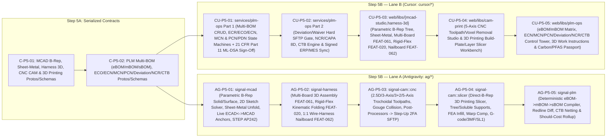

# Phase 5 Plan — Integrated Mechanical CAD (`CAD_MCAD`), CNC CAM (`CAM_CNC`), 3D Printing (`PRINT_3D`), Harness 3D & Native PLM / Operations (`PLM_OPS`)

> **Phase Goal:** Build Signal's first-class Mechanical CAD (`CAD_MCAD`), Subtractive 2.5D–5-Axis CNC CAM (`CAM_CNC`), Additive Direct-B-Rep 3D Printing (`PRINT_3D`), Multi-Board & Wire-Harness 3D (`FEAT-020`, `FEAT-061`, `FEAT-062`), Unified `wgpu` 3D Visualization, and Native PLM & Supply-Chain Operations (`PLM_OPS`: `eBOM`/`mBOM`/`sBOM`, `ECR`/`ECO`/`ECN`, `MCN`, `PCN`/`PDN`, time/qty-bounded `Deviation`/`Waiver` with hard SFTP release gate, `NCR`/`CAPA` 8D, Clear-to-Build `CTB`, 3D Interactive Assembly Work Instructions, Digital Product Passport & ERP/MES sync) across `signal-mcad`, `signal-harness`, `signal-cam`, `signal-plm`, `services/plm-ops`, and `web/libs/{mcad-studio,harness-3d,cam-print,plm-ops}`.  
> **Governing Specs:** [`19`](../architecture/19-cad-cam-3d-printing-and-plm-operations.md), [`17`](../architecture/17-extended-feature-specifications-ui-and-rust.md), [`07`](../architecture/07-security-encryption-dlp-and-sftp.md)  
> **Ledgers to Tick:** [`TODO-LEDGER-SHARED-CONTRACTS.md`](./TODO-LEDGER-SHARED-CONTRACTS.md) • [`TODO-LEDGER-ANTIGRAVITY-LANE-A.md`](./TODO-LEDGER-ANTIGRAVITY-LANE-A.md) • [`TODO-LEDGER-CURSOR-LANE-B.md`](./TODO-LEDGER-CURSOR-LANE-B.md)

---

## 1. Execution Wave Order

---

## 2. Step 5A — Serialized Contract Freeze (`contracts/**` ONLY)

### `C-P5-01` — Mechanical CAD (`CAD_MCAD`), Harness 3D, Subtractive CNC (`CAM_CNC`) & Additive 3D Printing (`PRINT_3D`) Contracts
- **Branch:** `contract/C-P5-01-mcad-cam-print-protos` | **Touched Paths:** `contracts/proto/signal/v1/mcad_cam_print.proto`, `contracts/schemas/mcad-feature-tree.schema.json`, `contracts/fixtures/mcad_cam_*.json`
- **Skills:** `signal-contract-first`, `signal-cad-cam-plm-ops`, `signal-verification-and-pr-gate`
- **Deliverables:** Finalize `mcad_cam_print.proto` (`bigint` `_nm` coordinates, `McadFeatureNode`, `EcadMcadAnchor`, `CncOperation`, `CncSimulationReport`, `Print3dJob`, `SlicingReport`, and RPCs for `FEAT-020`, `FEAT-061`, `FEAT-062`).
- **Verify & Tick:** `./signal.sh check --target contracts` → Tick `C-P5-01` in [`TODO-LEDGER-SHARED-CONTRACTS.md`](./TODO-LEDGER-SHARED-CONTRACTS.md).

### `C-P5-02` — Native PLM & Operations (`PLM_OPS`: Multi-BOM, `ECO`/`ECN`/`MCN`/`PCN`/`Deviation`/`NCR`/`CTB`) Contracts
- **Branch:** `contract/C-P5-02-plm-ops-protos` | **Touched Paths:** `contracts/proto/signal/v1/plm_ops.proto`, `contracts/schemas/mbom-structure.schema.json`, `contracts/transcripts/ecn_deviation_sftp_gate.jsonl`
- **Skills:** `signal-contract-first`, `signal-cad-cam-plm-ops`, `signal-verification-and-pr-gate`
- **Deliverables:** Finalize `plm_ops.proto` & `mbom-structure.schema.json` covering `BomLineItem` (`eBOM`/`mBOM`/`sBOM`), `EngineeringChangeOrder` (`ECR`/`ECO`/`ECN`), `ManufacturingChangeNotice` (`MCN`), `PartChangeNotice` (`PCN`/`PDN`), `DeviationWaiver` (`authorized_qty_limit`, `expires_at_utc`), `NcrCapaRecord`, and `ClearToBuildReport`.
- **Verify & Tick:** `./signal.sh check --target contracts` → Tick `C-P5-02` in [`TODO-LEDGER-SHARED-CONTRACTS.md`](./TODO-LEDGER-SHARED-CONTRACTS.md).

---

## 3. Step 5B — Lane A: Antigravity Parallel Tasks (`ag/*`)

### `AG-P5-01` — `signal-mcad`: Parametric B-Rep Solid/Surface Kernel, 2D Sketch Constraint Solver, Sheet-Metal Unfolder & Live ECAD↔MCAD Anchors
- **Branch:** `ag/AG-P5-01-signal-mcad` | **Touched Paths:** `engine/crates/signal-mcad/**`
- **Skills:** `signal-cad-cam-plm-ops`, `signal-rust-physics-and-geometry`, `signal-verification-and-pr-gate`
- **Deliverables:**
  1. Pure-Rust `#![forbid(unsafe_code)]` Parametric B-Rep & NURBS solid/surface kernel (`Extrude`, `Revolve`, `Loft`, `Sweep`, `Fillet`, `Chamfer`, `Shell`, `Draft`, `Rib`, `Boss`, `SnapHook`, `VentGrille`, `GasketGroove`) + 2D Levenberg-Marquardt/Dogleg sketch constraint solver (`19-*`).
  2. Sheet-metal bend-allowance ($K$-factor) flat-pattern unfolder, **Live Zero-File-Import ECAD↔MCAD Parametric Anchors** (mounting holes, connector cutouts, heatsink bosses, keepouts auto-update in `< 50 ms` on PCB edit, `F-113`/Risk 7), 3D BVH interference & IP-rating gasket compression verifier, and STEP AP242 (with PMI/GD&T), IGES, Parasolid, JT, glTF 2.0, and 3MF parsers/writers.
- **Verify & Tick:** `./signal.sh check --target rust-pod` → Tick `AG-P5-01` in [`TODO-LEDGER-ANTIGRAVITY-LANE-A.md`](./TODO-LEDGER-ANTIGRAVITY-LANE-A.md).

### `AG-P5-02` — `signal-harness`: Multi-Board 3D Assembly (`FEAT-061`), Rigid-Flex Kinematic Folding (`FEAT-020`) & 1:1 Wire-Harness Nailboard (`FEAT-062`)
- **Branch:** `ag/AG-P5-02-signal-harness` | **Touched Paths:** `engine/crates/signal-harness/**`
- **Skills:** `signal-cad-cam-plm-ops`, `signal-rust-physics-and-geometry`, `signal-verification-and-pr-gate`
- **Deliverables:**
  1. **`FEAT-061`** (`assembly_3d`: multi-board + MCAD enclosure mate constraints, dynamic cross-sectioning, end-to-end board-to-board net tracing), **`FEAT-020`** (`flex_kinematics`: neutral-axis cylindrical/conical bend transform + outer-fiber copper tensile strain $\epsilon = t / (2R_{\text{bend}})$ & staggered tear-stop check), and **`FEAT-062`** (`nailboard`: 3D spline bundle routing → flattened 1:1 manufacturing formboard, cut-strip-crimp table, IPC/WHMA-A-620 voltage-drop & ampacity verifier).
- **Verify & Tick:** `./signal.sh check --target rust-pod` → Tick `AG-P5-02` in [`TODO-LEDGER-ANTIGRAVITY-LANE-A.md`](./TODO-LEDGER-ANTIGRAVITY-LANE-A.md).

### `AG-P5-03` — `signal-cam::cnc`: Subtractive 2.5D / 3-Axis / 3+2 / 5-Axis Adaptive Trochoidal CNC Toolpaths, Gouge Collision & Post-Processors (`CAM_CNC`)
- **Branch:** `ag/AG-P5-03-signal-cam-cnc` | **Touched Paths:** `engine/crates/signal-cam/src/cnc/**`
- **Skills:** `signal-cad-cam-plm-ops`, `signal-rust-physics-and-geometry`, `signal-verification-and-pr-gate`
- **Deliverables:**
  1. Constant-engagement adaptive trochoidal clearing, rest machining, waterline/scallop 3D finishing, 3+2 indexed & simultaneous 5-axis swarf/impeller machining, thread milling, and PCB prototype isolation milling (`19-*`).
  2. Real-time Octree/Dexel material-removal volume simulator with **holder/shank/spindle/fixture gouge & collision detection**, chip-load/spindle-torque feedrate optimizer, and deterministic G-code post-processors (`Fanuc`, `Siemens 840D`, `Haas`, `Heidenhain`, `Mazak`, `GRBL/LinuxCNC`) streamed exclusively via Step-Up 2FA `signal-sftp-egress`.
- **Verify & Tick:** `./signal.sh check --target rust-pod` → Tick `AG-P5-03` in [`TODO-LEDGER-ANTIGRAVITY-LANE-A.md`](./TODO-LEDGER-ANTIGRAVITY-LANE-A.md).

### `AG-P5-04` — `signal-cam::slicer`: Direct-B-Rep Additive 3D Printing Slicer, Tree/Soluble Supports & Thermal Warp Compensation (`PRINT_3D`)
- **Branch:** `ag/AG-P5-04-signal-cam-slicer` | **Touched Paths:** `engine/crates/signal-cam/src/slicer/**`
- **Skills:** `signal-cad-cam-plm-ops`, `signal-rust-physics-and-geometry`, `signal-verification-and-pr-gate`
- **Deliverables:**
  1. **Direct-B-Rep & Mesh Parallel Slicing Engine** (slices analytic NURBS/B-Rep surfaces directly without faceted STL chordal loss!) across `FDM/FFF`, `SLA/MSLA`, `SLS/MJF`, and `DMLS/SLM` metal LPBF (`19-*`).
  2. Auto-orientation & 3D nesting, organic tree/soluble/breakaway/metal-heat-sink supports, **FEA-stress-guided variable-density gyroid/Voronoi infill**, conductive-filament/pick-and-place pause-layer PCB embedding, and thermal shrinkage/warp pre-deformation + in-memory `G-code`/`3MF`/`SL1`/`CLI` SFTP writers.
- **Verify & Tick:** `./signal.sh check --target rust-pod` → Tick `AG-P5-04` in [`TODO-LEDGER-ANTIGRAVITY-LANE-A.md`](./TODO-LEDGER-ANTIGRAVITY-LANE-A.md).

### `AG-P5-05` — `signal-plm`: Deterministic `eBOM` → `mBOM` → `sBOM` Compiler, Semantic Redline Diff, `CTB` Netting & Should-Cost Rollup
- **Branch:** `ag/AG-P5-05-signal-plm-kernel` | **Touched Paths:** `engine/crates/signal-plm/**`
- **Skills:** `signal-cad-cam-plm-ops`, `signal-rust-crate-architect`, `signal-verification-and-pr-gate`
- **Deliverables:**
  1. Multi-domain BOM compiler merging ECAD (`signal-schematic`/`signal-pcb` + `parts.lock.json`) + MCAD (`signal-mcad` enclosures/fasteners/gaskets) + CAM/Print (`signal-cam` raw stock/resin/powder + setup/cycle time) + Packaging/Test Fixtures into synchronized **`eBOM`**, **`mBOM`**, **`sBOM`**, and **Costed & Carbon/RoHS/REACH/PFAS Digital Product Passport BOM** (`19-*`, `F-112`).
  2. Structural/geometric/routing/firmware delta engine for `ECO`/`ECN` redlines and deterministic Clear-to-Build (`CTB`) inventory/AVL netting solver.
- **Verify & Tick:** `./signal.sh check --target rust-pod` → Tick `AG-P5-05` in [`TODO-LEDGER-ANTIGRAVITY-LANE-A.md`](./TODO-LEDGER-ANTIGRAVITY-LANE-A.md).

---

## 4. Step 5B — Lane B: Cursor Parallel Tasks (`cursor/*`)

### `CU-P5-01` — `services/plm-ops` (Part 1): Multi-BOM CRUD, `ECR`/`ECO`/`ECN`, `MCN` & `PCN`/`PDN` Workflows with 21 CFR Part 11 `ML-DSA` Sign-Off
- **Branch:** `cursor/CU-P5-01-plm-ops-eco-mcn-pcn` | **Touched Paths:** `services/plm-ops/src/{bom,eco,mcn,pcn}/**`
- **Skills:** `signal-cad-cam-plm-ops`, `signal-fastapi-control-plane`, `signal-security-isolation-audit`
- **Deliverables:**
  1. Stateless FastAPI endpoints + Postgres `19+` `with_rls_tx` persistence + `<project>-ops` BYO-Git signed commit sync for `eBOM`/`mBOM`/`sBOM`, **`ECR` → `ECO` → `ECN`** (with `WIP`/`In-Stock`/`Field` disposition & CCB quorum), **`MCN`** (routing/workstation/fixture/CNC/slicer/torque changes), and **`PCN`/`PDN`** (auto-matching distributor/vendor EOL notifications against `parts.lock.json` and spawning impact `ECR`s).
- **Verify & Tick:** `./signal.sh check --target api` → Tick `CU-P5-01` in [`TODO-LEDGER-CURSOR-LANE-B.md`](./TODO-LEDGER-CURSOR-LANE-B.md).

### `CU-P5-02` — `services/plm-ops` (Part 2): Time/Qty-Bounded `Deviation`/`Waiver` Hard SFTP Gate, `NCR`/`CAPA` 8D, `CTB` Engine & Signed ERP/MES Sync
- **Branch:** `cursor/CU-P5-02-plm-ops-deviation-ncr-ctb-erp` | **Touched Paths:** `services/plm-ops/src/{deviation,ncr_capa,ctb,erp_sync}/**`
- **Skills:** `signal-cad-cam-plm-ops`, `signal-fastapi-control-plane`, `signal-security-isolation-audit`
- **Deliverables:**
  1. **Hard `Deviation` / `Waiver` Enforcement (`19-*`):** Tracks `authorized_qty_limit`, `consumed_qty`, and `expires_at_utc`; **automatically blocks `services/sftp-egress` manufacturing releases** once quantity or expiration is exceeded unless renewed via Step-Up 2FA CCB sign-off!
  2. **`NCR` & `CAPA` (8D Loop)** linked to 3D PCB/MCAD serial numbers, **Clear-to-Build (`CTB`)** line-stoppage detector, and bidirectional **SAP / Oracle NetSuite / Arena / Propel / Katana / Factory MES** webhook sync via `signal-egress-proxy`.
- **Verify & Tick:** `./signal.sh check --target api` → Tick `CU-P5-02` in [`TODO-LEDGER-CURSOR-LANE-B.md`](./TODO-LEDGER-CURSOR-LANE-B.md).

### `CU-P5-03` — `web/libs/{mcad-studio,harness-3d}`: Parametric B-Rep CAD Workbench, Sheet-Metal, Multi-Board (`FEAT-061`), Rigid-Flex (`FEAT-020`) & Nailboard (`FEAT-062`)
- **Branch:** `cursor/CU-P5-03-mcad-and-harness-3d-ui` | **Touched Paths:** `web/libs/{mcad-studio,harness-3d}/**`
- **Skills:** `signal-cad-cam-plm-ops`, `signal-angular-workbench`, `signal-angular-ui-style-system`, `signal-zero-leak-canvas-and-dlp`
- **Deliverables:**
  1. `web/libs/mcad-studio`: Parametric feature-tree timeline, 2D constraint sketcher HUD, sheet-metal flat-pattern dual view, Live ECAD↔MCAD Anchor Manager, and Unified Exploded View & Section-Plane slider (`19-*`).
  2. `web/libs/harness-3d`: **`FEAT-061`** (`MultiBoardAssemblyViewport`), **`FEAT-020`** (`FlexFoldSliderHud` `0%–100%` kinematic folding & copper strain), and **`FEAT-062`** (`HarnessNailboardCanvas` 1:1 formboard & cut/crimp table).
- **Verify & Tick:** `./signal.sh check --target ui` → Tick `CU-P5-03` in [`TODO-LEDGER-CURSOR-LANE-B.md`](./TODO-LEDGER-CURSOR-LANE-B.md).

### `CU-P5-04` — `web/libs/cam-print`: Subtractive 5-Axis CNC Toolpath Simulator & Additive Direct-B-Rep 3D Printing Slicer Workbench
- **Branch:** `cursor/CU-P5-04-cam-print-ui` | **Touched Paths:** `web/libs/cam-print/**`
- **Skills:** `signal-cad-cam-plm-ops`, `signal-angular-workbench`, `signal-angular-ui-style-system`
- **Deliverables:**
  1. Strict 4-file Angular `v22+` components in `web/libs/cam-print`: CNC setup/tool-crib/operation tree, live 3D voxel stock-removal & gouge-collision scrub player, 3D printing build-plate nesting & support editor, 2D/3D layer-by-layer nozzle/laser G-code previewer, and 1-click Step-Up 2FA SFTP machine dispatch (`19-*`).
- **Verify & Tick:** `./signal.sh check --target ui` → Tick `CU-P5-04` in [`TODO-LEDGER-CURSOR-LANE-B.md`](./TODO-LEDGER-CURSOR-LANE-B.md).

### `CU-P5-05` — `web/libs/plm-ops`: Multi-BOM (`eBOM`/`mBOM`/`sBOM`), `ECN`/`MCN`/`PCN`/`Deviation`/`NCR`/`CTB` Control Tower & 3D Assembly Work Instructions
- **Branch:** `cursor/CU-P5-05-plm-ops-ui` | **Touched Paths:** `web/libs/plm-ops/**`
- **Skills:** `signal-cad-cam-plm-ops`, `signal-angular-workbench`, `signal-angular-ui-style-system`
- **Deliverables:**
  1. Synchronized `eBOM` ↔ `mBOM` ↔ `sBOM` tree-grid with Cost/Lead-Time/RoHS/REACH/PFAS/Carbon Digital Product Passport badges (`F-112`), visual `ECR`/`ECO`/`ECN` & `MCN` redline approval workflow with 21 CFR Part 11 Step-Up 2FA sign-off modal, `PCN` impact matrix, `Deviation`/`Waiver` active countdown & qty meter, `NCR`/`CAPA` 8D board, `CTB` shortage waterfall, and Zero-Leak **Interactive 3D Step-by-Step Factory Assembly Work Instruction Viewer** (`19-*`).
- **Verify & Tick:** `./signal.sh check --target ui` → Tick `CU-P5-05` in [`TODO-LEDGER-CURSOR-LANE-B.md`](./TODO-LEDGER-CURSOR-LANE-B.md).
