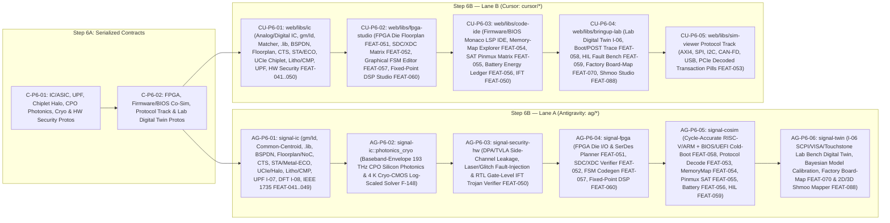

# Phase 6 Plan — IC/ASIC (`IC_*`), Photonics/Cryo, FPGA, Firmware/BIOS Co-Sim, Hardware Security & Lab Digital Twin

> **Phase Goal:** Build Signal's Analog/Digital/Mixed-Signal IC & 2.5D/3D-IC Chiplet flow (`signal-ic`, `FEAT-041`–`049`, IEEE 1801 UPF `I-07`, DFT/Scan/ATPG `I-08`, HSM IEEE 1735 PDK decryptor, `*.halo.gds.sig` zero-lateral-movement federation), Baseband-Envelope CPO Silicon Photonics & 4 K Cryo-CMOS (`F-148`), Hardware Security DPA/TVLA & RTL IFT Trojan Verifier (`signal-security-hw`, `FEAT-050`), FPGA Studio (`signal-fpga`, `FEAT-051`, `052`, `057`, `060`), Cycle-Accurate MCU/Firmware/BIOS/UEFI/Coreboot Co-Simulation (`signal-cosim`, `FEAT-053`–`056`, `058`, `059`), and Post-Silicon Lab Bench Digital Twin & Shmoo Mapper (`signal-twin` `I-06`, `FEAT-070`, `088`).  
> **Governing Specs:** [`01`](../architecture/01-product-vision-and-features.md), [`03`](../architecture/03-rust-eda-engine.md), [`14`](../architecture/14-universal-scale-accessibility-and-expandability.md), [`15`](../architecture/15-application-security-and-project-isolation.md), [`16`](../architecture/16-architectural-audit-flaws-and-futuristic-innovations.md), [`17`](../architecture/17-extended-feature-specifications-ui-and-rust.md)  
> **Ledgers to Tick:** [`TODO-LEDGER-SHARED-CONTRACTS.md`](./TODO-LEDGER-SHARED-CONTRACTS.md) • [`TODO-LEDGER-ANTIGRAVITY-LANE-A.md`](./TODO-LEDGER-ANTIGRAVITY-LANE-A.md) • [`TODO-LEDGER-CURSOR-LANE-B.md`](./TODO-LEDGER-CURSOR-LANE-B.md)

---

## 1. Execution Wave Order

---

## 2. Step 6A — Serialized Contract Freeze (`contracts/**` ONLY)

### `C-P6-01` — IC/ASIC, IEEE 1801 UPF (`I-07`), DFT (`I-08`), Chiplet Halo Views, CPO Photonics, Cryo & Hardware Security Contracts
- **Branch:** `contract/C-P6-01-ic-photonics-security-protos` | **Touched Paths:** `contracts/proto/signal/v1/**`, `contracts/schemas/upf-power-intent.schema.json`
- **Skills:** `signal-contract-first`, `signal-verification-and-pr-gate`
- **Deliverables:** Finalize Protobuf RPCs (`bigint` `_nm`, `_ps`, `_fs`, `_uv`) & UPF schema for `FEAT-041`–`FEAT-050`, `I-07`, `I-08`, `F-010`/`F-125` (`*.lef.sig`, `*.halo.gds.sig`), and `F-148` (CPO/Cryo).
- **Verify & Tick:** `./signal.sh check --target contracts` → Tick `C-P6-01` in [`TODO-LEDGER-SHARED-CONTRACTS.md`](./TODO-LEDGER-SHARED-CONTRACTS.md).

### `C-P6-02` — FPGA, Cycle-Accurate Firmware/BIOS Co-Sim, Bus Protocol Decoder & Lab Digital Twin (`I-06`) Contracts
- **Branch:** `contract/C-P6-02-fpga-cosim-twin-protos` | **Touched Paths:** `contracts/proto/signal/v1/**`, `contracts/fixtures/cosim_twin_*.json`
- **Skills:** `signal-contract-first`, `signal-verification-and-pr-gate`
- **Deliverables:** Finalize Protobuf RPCs for `FEAT-051`–`FEAT-060`, `FEAT-070`, `FEAT-088`, and `I-06` (`LabMeasurementOverlay`, `ShmooSweepMatrix`, `ProtocolPacketSpan`).
- **Verify & Tick:** `./signal.sh check --target contracts` → Tick `C-P6-02` in [`TODO-LEDGER-SHARED-CONTRACTS.md`](./TODO-LEDGER-SHARED-CONTRACTS.md).

---

## 3. Step 6B — Lane A: Antigravity Parallel Tasks (`ag/*`)

### `AG-P6-01` — `signal-ic`: Analog/Digital RTL-to-GDSII/OASIS, `gm/Id`, Common-Centroid, `.lib`, BSPDN, CTS, STA/Metal-ECO, UCIe Chiplets, Pelgrom/LVF, UPF (`I-07`), DFT (`I-08`) & IEEE 1735 (`FEAT-041`–`049`)
- **Branch:** `ag/AG-P6-01-signal-ic-engine` | **Touched Paths:** `engine/crates/signal-ic/**`
- **Skills:** `signal-rust-physics-and-geometry`, `signal-security-isolation-audit`, `signal-verification-and-pr-gate`
- **Deliverables:**
  1. **`FEAT-041`** (`gmid_lut` 4D tensor interpolation), **`FEAT-042`** (`analog_placer` `ABBA` common-centroid/dummy guard-ring & Pelgrom $\sigma^2(\Delta P) = A_P^2 / (WL) + S_P^2 D^2$ mismatch solver, `F-137`), **`FEAT-043`** (`lib_char` 7x7 NLDM/CCS `.lib` characterizer + Liberty Moment/LVF SSTA, `F-137`), **`FEAT-044`** (`bspdn` Backside PowerVia & nano-TSV IR/thermal solver), **`FEAT-045`** (`floorplan_noc` SA/analytical macro placer & NoC router), **`FEAT-046`** (`cts_mesh` DME zero-skew H-tree/mesh), **`FEAT-047`** (`sta_eco` path-based STA & **Post-Mask Spare-Cell Metal-Only IC ECO**, `F-134`), **`FEAT-048`** (`chiplet_ucie` 2.5D/3D micro-bump & UCIe solver + **Cryptographically Signed `*.lef.sig`/`*.halo.gds.sig` `5 um` Boundary-Halo Abstract Views** via `signal-federation-broker` preserving 100% lateral pod drop!, `F-010`, `F-125`), and **`FEAT-049`** (`litho_cmp` Hopkins 2D FFT aerial-image & dummy-fill generator).
  2. **IEEE 1801 UPF Power-Domain Verifier (`I-07`, `F-037`)**, **Scan/BIST/ATPG & IEEE 1687 IJTAG Synthesizer (`I-08`, `F-038`)**, and **HSM-Backed IEEE 1735 v2 Encrypted Foundry PDK Session Decryptor** (`F-114`).
- **Verify & Tick:** `./signal.sh check --target rust-pod` → Tick `AG-P6-01` in [`TODO-LEDGER-ANTIGRAVITY-LANE-A.md`](./TODO-LEDGER-ANTIGRAVITY-LANE-A.md).

### `AG-P6-02` — `signal-ic::photonics_cryo`: Baseband-Envelope `193 THz` CPO Silicon Photonics & `4 K` Cryo-CMOS Solver (`F-148`)
- **Branch:** `ag/AG-P6-02-photonics-and-cryo-cmos` | **Touched Paths:** `engine/crates/signal-ic/src/{photonics_cpo,cryo_cmos}/**`
- **Skills:** `signal-rust-physics-and-geometry`, `signal-verification-and-pr-gate`
- **Deliverables:**
  1. **Complex Baseband-Envelope Optical MNA (`F-148`, `14-*`):** Represents optical waveguide signals as complex baseband envelopes $A(t)e^{j\phi(t)}$ around $\omega_0$ (`1310 nm`/`1550 nm`) + `2x2` complex scattering matrices for ring modulators, Mach-Zehnder interferometers, and photodetectors at picosecond electrical step sizes (`10^4x` faster than femtosecond carrier stepping!).
  2. **`4 K–300 K` Cryo-CMOS Solver (`F-148`, `14-*`):** Effective floor temperature $T_{\text{eff}}(T) = \sqrt{T^2 + T_0^2}$ + log-domain Fermi-Dirac smooth continuation preventing $\exp(-qV/k_BT)$ overflow at `4 K` liquid-helium / `20 mK` dilution stages.
- **Verify & Tick:** `./signal.sh check --target rust-pod` → Tick `AG-P6-02` in [`TODO-LEDGER-ANTIGRAVITY-LANE-A.md`](./TODO-LEDGER-ANTIGRAVITY-LANE-A.md).

### `AG-P6-03` — `signal-security-hw`: DPA/TVLA Side-Channel Leakage, Fault-Injection & RTL Gate-Level IFT Trojan Verifier (`FEAT-050`)
- **Branch:** `ag/AG-P6-03-signal-security-hw` | **Touched Paths:** `engine/crates/signal-security-hw/**`
- **Skills:** `signal-rust-physics-and-geometry`, `signal-security-isolation-audit`, `signal-verification-and-pr-gate`
- **Deliverables:**
  1. **`FEAT-050`**: Dynamic power-trace $I_{DD}(t)$ correlation simulator computing Welch's $t$-test **TVLA ($|t| > 4.5$)** & CPA/DPA correlation across AES/PQC keys, clock/voltage-glitch & laser single-bit fault-injection FSM bypass solver, and Gate-Level Information-Flow Tracking (GLIFT) proving key bits never reach unmasked I/O pins.
- **Verify & Tick:** `./signal.sh check --target rust-pod` → Tick `AG-P6-03` in [`TODO-LEDGER-ANTIGRAVITY-LANE-A.md`](./TODO-LEDGER-ANTIGRAVITY-LANE-A.md).

### `AG-P6-04` — `signal-fpga`: FPGA Die I/O & SerDes Planner (`FEAT-051`), SDC/XDC Verifier (`FEAT-052`), FSM Codegen (`FEAT-057`) & Fixed-Point DSP (`FEAT-060`)
- **Branch:** `ag/AG-P6-04-signal-fpga` | **Touched Paths:** `engine/crates/signal-fpga/**`
- **Skills:** `signal-rust-physics-and-geometry`, `signal-verification-and-pr-gate`
- **Deliverables:**
  1. **`FEAT-051`** (`io_planner` AMD/Xilinx UltraScale+/Versal, Intel Agilex, Lattice, Gowin bank $V_{CCO}$, LVDS termination, SSN & PCB dogbone escape cost), **`FEAT-052`** (`sdc_verifier` structural CDC/false-path/multicycle verifier + `yosys`/`nextpnr` bridge), **`FEAT-057`** (`fsm_codegen` bidirectional FSM ↔ SystemVerilog/VHDL/Chisel AST + unreachable/deadlock check), and **`FEAT-060`** (`dsp_fixedpoint` Parks-McClellan/Remez `Q(m.n)` quantization SQNR/limit-cycle analyzer + synthesizable RTL & `no_std` Rust/C generator).
- **Verify & Tick:** `./signal.sh check --target rust-pod` → Tick `AG-P6-04` in [`TODO-LEDGER-ANTIGRAVITY-LANE-A.md`](./TODO-LEDGER-ANTIGRAVITY-LANE-A.md).

### `AG-P6-05` — `signal-cosim`: Cycle-Accurate MCU + BIOS/UEFI Cold-Boot (`FEAT-058`), Protocol Decoder (`FEAT-053`), Memory-Map (`FEAT-054`), SAT Pinmux (`FEAT-055`), Battery Profiler (`FEAT-056`) & Virtual HIL (`FEAT-059`)
- **Branch:** `ag/AG-P6-05-signal-cosim` | **Touched Paths:** `engine/crates/signal-cosim/**`
- **Skills:** `signal-rust-physics-and-geometry`, `signal-verification-and-pr-gate`
- **Deliverables:**
  1. Lockstep cycle-accurate RISC-V / ARM Cortex-M / x86-PMU instruction emulator + mixed-signal MNA co-simulator: **`FEAT-058`** (`boot_verifier` power-on reset → PMIC rails → clock PLL lock → SPI Flash → Coreboot/UEFI/ACPI/Device-Tree `.dts` pin/address consistency), **`FEAT-053`** (`protocol_decode` streaming `AXI4`/`SPI`/`I2C`/`CAN-FD`/`USB-PD`/`PCIe` packet decoder), **`FEAT-054`** (`memmap_svd` CMSIS-SVD `.svd` + linker `.ld` + `.dts` interval-tree overlap detector), **`FEAT-055`** (`pinmux_sat` Incremental MaxSAT pinmux & PCB crossing minimizer + HAL generator), **`FEAT-056`** (`energy_profiler` $\int V_{DD}(t)I_{DD}(t)\,dt$ per ELF PC symbol & multi-year battery estimator), and **`FEAT-059`** (`hil_watchdog` scripted brownout/CRC/sensor-disconnect fault runner).
- **Verify & Tick:** `./signal.sh check --target rust-pod` → Tick `AG-P6-05` in [`TODO-LEDGER-ANTIGRAVITY-LANE-A.md`](./TODO-LEDGER-ANTIGRAVITY-LANE-A.md).

### `AG-P6-06` — `signal-twin` (`I-06`): Lab Bench Digital Twin Correlation, Factory Board-Map (`FEAT-070`) & 2D/3D Shmoo Mapper (`FEAT-088`)
- **Branch:** `ag/AG-P6-06-signal-twin` | **Touched Paths:** `engine/crates/signal-twin/**`
- **Skills:** `signal-rust-physics-and-geometry`, `signal-verification-and-pr-gate`
- **Deliverables:**
  1. `signal-twin` (`I-06`, `F-111`): Ingests SCPI / VISA / Sigrok / Touchstone `.sNp` / CSV captures from lab oscilloscopes, VNAs, logic analyzers, and thermal cameras; runs **Bayesian / Saltation-Adjoint model calibration** to fit parasitic ESR/ESL/dielectric constants to measured silicon/board hardware.
  2. **`FEAT-070`** (`board_debug` net-expected nominal voltage/impedance/frequency lookup for technician bench bring-up) and **`FEAT-088`** (`shmoo_runner` adaptive coarse-to-fine 2D/3D $(V_{DD}, f_{\text{clk}}, T_A)$ grid evaluator + simulated-vs-ATE boundary overlay).
- **Verify & Tick:** `./signal.sh check --target rust-pod` → Tick `AG-P6-06` in [`TODO-LEDGER-ANTIGRAVITY-LANE-A.md`](./TODO-LEDGER-ANTIGRAVITY-LANE-A.md).

---

## 4. Step 6B — Lane B: Cursor Parallel Tasks (`cursor/*`)

### `CU-P6-01` — `web/libs/ic`: Analog/Digital IC, `gm/Id`, Matcher, `.lib`, BSPDN, Floorplan, CTS, STA/ECO, UCIe Chiplets, Litho/CMP, CPO/Cryo & HW Security (`FEAT-041`–`050`)
- **Branch:** `cursor/CU-P6-01-ic-workbench-ui` | **Touched Paths:** `web/libs/ic/**`
- **Skills:** `signal-angular-workbench`, `signal-angular-ui-style-system`, `signal-zero-leak-canvas-and-dlp`
- **Deliverables:**
  1. Strict 4-file Angular `v22+` components in `web/libs/ic`: **`FEAT-041`** (`GmIdExplorerPanel`), **`FEAT-042`** (`AnalogMatcherWizard`), **`FEAT-043`** (`LibertyCharStudioComponent`), **`FEAT-044`** (`BspdnDualSideViewport`), **`FEAT-045`** (`SocFloorplanStudioComponent`), **`FEAT-046`** (`CtsTreeVisualizerPanel`), **`FEAT-047`** (`StaPathDebuggerComponent` + Post-Mask Metal ECO preview), **`FEAT-048`** (`ChipletInterposerStudio` + Halo-view boundary inspector), **`FEAT-049`** (`LithoCmpOverlayLayer`), **`FEAT-050`** (`HwSecurityAuditPanel` TVLA/DPA & fault-injection map), UPF Power-Domain Overlay (`I-07`), and CPO Optical / 4K Cryo-CMOS mode panels (`F-148`).
- **Verify & Tick:** `./signal.sh check --target ui` → Tick `CU-P6-01` in [`TODO-LEDGER-CURSOR-LANE-B.md`](./TODO-LEDGER-CURSOR-LANE-B.md).

### `CU-P6-02` — `web/libs/fpga-studio`: FPGA Die Floorplan (`FEAT-051`), SDC/XDC Wizard (`FEAT-052`), Graphical FSM Editor (`FEAT-057`) & Fixed-Point DSP Studio (`FEAT-060`)
- **Branch:** `cursor/CU-P6-02-fpga-studio-ui` | **Touched Paths:** `web/libs/fpga-studio/**`
- **Skills:** `signal-angular-workbench`, `signal-angular-ui-style-system`, `signal-verification-and-pr-gate`
- **Deliverables:**
  1. **`FEAT-051`** (`FpgaDieFloorplanComponent` with live PCB ratline cross-probe), **`FEAT-052`** (`SdcConstraintMatrixComponent`), **`FEAT-057`** (`FsmCanvasEditorComponent` bidirectional state-bubble ↔ RTL editor), and **`FEAT-060`** (`DspFilterStudioComponent` pole-zero $z$-plane & fixed-point `Q(m.n)` bit-width sliders).
- **Verify & Tick:** `./signal.sh check --target ui` → Tick `CU-P6-02` in [`TODO-LEDGER-CURSOR-LANE-B.md`](./TODO-LEDGER-CURSOR-LANE-B.md).

### `CU-P6-03` — `web/libs/code-ide`: Firmware & BIOS/UEFI IDE, Memory-Map Explorer (`FEAT-054`), SAT Pinmux Matrix (`FEAT-055`), Battery Energy Ledger (`FEAT-056`) & RTL IFT (`FEAT-050`)
- **Branch:** `cursor/CU-P6-03-code-ide-ui` | **Touched Paths:** `web/libs/code-ide/**`
- **Skills:** `signal-angular-workbench`, `signal-angular-ui-style-system`, `signal-verification-and-pr-gate`
- **Deliverables:**
  1. On-demand windowed Monaco + Rust-Analyzer / Verible / clangd LSP IDE (`F-069`), **`FEAT-054`** (`MemoryMapExplorerComponent`), **`FEAT-055`** (`PinmuxMatrixComponent` 1-click SAT auto-assign & C/Rust/Zephyr `.dts` export), **`FEAT-056`** (`BatteryEnergyLedgerComponent` mJ-per-function flamegraph), and **`FEAT-050`** (RTL IFT taint-path highlighter).
- **Verify & Tick:** `./signal.sh check --target ui` → Tick `CU-P6-03` in [`TODO-LEDGER-CURSOR-LANE-B.md`](./TODO-LEDGER-CURSOR-LANE-B.md).

### `CU-P6-04` — `web/libs/bringup-lab`: Lab Digital Twin (`I-06`), Cold-Boot/POST Trace (`FEAT-058`), Virtual HIL Bench (`FEAT-059`), Factory Board-Map (`FEAT-070`) & Shmoo Studio (`FEAT-088`)
- **Branch:** `cursor/CU-P6-04-bringup-lab-ui` | **Touched Paths:** `web/libs/bringup-lab/**`
- **Skills:** `signal-angular-workbench`, `signal-angular-ui-style-system`, `signal-verification-and-pr-gate`
- **Deliverables:**
  1. Lab Digital Twin Bench Connection & Model-Calibration Workbench (`I-06`), **`FEAT-058`** (`BootTraceVisualizerComponent`), **`FEAT-059`** (`HilFaultScenarioRunner`), **`FEAT-070`** (`InteractiveBoardMapComponent` touch-friendly technician bring-up map), and **`FEAT-088`** (`ShmooPlotStudioComponent` 2D/3D pass/fail grid with click-to-open-waveform).
- **Verify & Tick:** `./signal.sh check --target ui` → Tick `CU-P6-04` in [`TODO-LEDGER-CURSOR-LANE-B.md`](./TODO-LEDGER-CURSOR-LANE-B.md).

### `CU-P6-05` — `web/libs/sim-viewer` Protocol Track: Live Decoded Bus Transaction Pills (`FEAT-053`)
- **Branch:** `cursor/CU-P6-05-sim-viewer-protocol-track` | **Touched Paths:** `web/libs/sim-viewer/src/lib/protocol-track/**`
- **Skills:** `signal-angular-workbench`, `signal-angular-ui-style-system`, `signal-verification-and-pr-gate`
- **Deliverables:**
  1. **`FEAT-053`** (`ProtocolTrackOverlay`: renders decoded `AXI4`, `SPI`, `I2C`, `CAN-FD`, `USB-PD`, and `PCIe` packet pills `START | ADDR 0x48 | DATA | ACK | CRC` directly above analog/digital waveforms with regex search & jump-to-NACK).
- **Verify & Tick:** `./signal.sh check --target ui` → Tick `CU-P6-05` in [`TODO-LEDGER-CURSOR-LANE-B.md`](./TODO-LEDGER-CURSOR-LANE-B.md).
