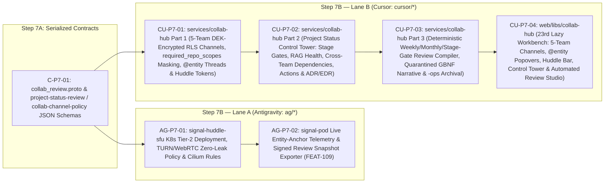

# Phase 7 Plan — Built-In 5-Team Collaboration Space, Live Project Status Control Tower & Automated Weekly/Monthly/Status Reviews

> **Phase Goal:** Build Signal's native Zero-Leak Cross-Team Collaboration Space uniting **Design, Development/Bring-Up, Software/Firmware, Manufacturing, and Operations/Supply-Chain** (`21-*`), per-project PQC DEK-encrypted RLS channels with `required_repo_scopes[]` RBAC masking, live `@entity` design anchors (`@U12`, `@Net:DDR_CLK`, `@ECN-118`, `@NCR-22`), encrypted WebRTC audio/video + live viewport-follow huddles (`signal-huddle-sfu`), the Live Project Status Control Tower (stage gates, RAG health, cross-team dependencies, action items, `ADR`/`EDR` decision log), and direct 1-click/scheduled **Weekly Engineering Review, Monthly Executive Review, and Stage-Gate Project Status Review** generation (replacing Slack, Microsoft Teams, Jira status noise, and manual PowerPoint decks).  
> **Governing Specs:** [`21`](../architecture/21-collaboration-space-project-status-and-automated-reviews.md), [`06`](../architecture/06-frontend-angular-and-fastapi-control-plane.md), [`07`](../architecture/07-security-encryption-dlp-and-sftp.md), [`17`](../architecture/17-extended-feature-specifications-ui-and-rust.md) (`FEAT-109`)  
> **Ledgers to Tick:** [`TODO-LEDGER-SHARED-CONTRACTS.md`](./TODO-LEDGER-SHARED-CONTRACTS.md) • [`TODO-LEDGER-ANTIGRAVITY-LANE-A.md`](./TODO-LEDGER-ANTIGRAVITY-LANE-A.md) • [`TODO-LEDGER-CURSOR-LANE-B.md`](./TODO-LEDGER-CURSOR-LANE-B.md)

---

## 1. Execution Wave Order

---

## 2. Step 7A — Serialized Contract Freeze (`contracts/**` ONLY)

### `C-P7-01` — 5-Team Collaboration, Project Status Control Tower & Automated Review Engine Contracts (`21-*`)
- **Branch:** `contract/C-P7-01-collab-and-reviews-protos` | **Touched Paths:** `contracts/proto/signal/v1/collab_review.proto`, `contracts/schemas/{project-status-review,collab-channel-policy}.schema.json`, `contracts/transcripts/weekly_and_stage_gate_review.jsonl`
- **Skills:** `signal-contract-first`, `signal-collab-and-status-reviews`, `signal-verification-and-pr-gate`
- **Deliverables:** Finalize `collab_review.proto` (`CollabChannelService`, `ProjectStatusService`, `AutomatedReviewService` with `bigint` `_nm`/`_ps`/`_utc_ms` fields, `TeamScope`, `EntityAnchorRef`, `StageGateMilestone`, `CrossTeamDependency`, `ActionItem`, `DecisionRecord`, and `GeneratedReviewPacket`).
- **Verify & Tick:** `./signal.sh check --target contracts` → Tick `C-P7-01` in [`TODO-LEDGER-SHARED-CONTRACTS.md`](./TODO-LEDGER-SHARED-CONTRACTS.md).

---

## 3. Step 7B — Lane A: Antigravity Parallel Tasks (`ag/*`)

### `AG-P7-01` — `signal-huddle-sfu`: Tier 2 (`pool-api`) Zero-Leak WebRTC Audio/Video & Viewport-Follow SFU Deployment
- **Branch:** `ag/AG-P7-01-huddle-sfu-k8s` | **Touched Paths:** `infra/k8s/helm/signal/templates/huddle-sfu-*.yaml`, `infra/k8s/policies/cilium-huddle-sfu.yaml`
- **Skills:** `signal-release-deploy-topology`, `signal-security-isolation-audit`, `signal-zero-leak-canvas-and-dlp`
- **Deliverables:**
  1. Co-locate `signal-huddle-sfu` inside Tier 2 (`pool-api`) behind `turns:443` + SPIFFE mTLS (`21-*`): authenticates short-lived Ed25519 huddle tickets issued by `services/collab-hub`, routes encrypted audio/video + 60 Hz camera-follow coordinate pointers, and **never records raw design geometry to disk**.
- **Verify & Tick:** `./signal.sh check --target k8s` → Tick `AG-P7-01` in [`TODO-LEDGER-ANTIGRAVITY-LANE-A.md`](./TODO-LEDGER-ANTIGRAVITY-LANE-A.md).

### `AG-P7-02` — `signal-pod` Live `@entity` Anchor Telemetry & Deterministic Review KPI Exporter (`21-*`, `FEAT-109`)
- **Branch:** `ag/AG-P7-02-pod-entity-kpi-exporter` | **Touched Paths:** `engine/crates/signal-pod/src/review_snapshot/**`
- **Skills:** `signal-rust-crate-architect`, `signal-collab-and-status-reviews`, `signal-verification-and-pr-gate`
- **Deliverables:**
  1. Fast gRPC endpoint on `signal-pod` returning live verified telemetry for any `@entity` anchor (`@U12`, `@Net:VOUT`, `@STEP:Housing_Top`, `@Toolpath:OP20`) AND computing deterministic engineering KPIs (`DRC/ERC/LVS violations = 0`, `SPICE worst-case SOA margin %`, `STA slack ps`, `3D MCAD interference = 0`) for the Automated Review Compiler (`21-*`, `FEAT-109`).
- **Verify & Tick:** `./signal.sh check --target rust-pod` → Tick `AG-P7-02` in [`TODO-LEDGER-ANTIGRAVITY-LANE-A.md`](./TODO-LEDGER-ANTIGRAVITY-LANE-A.md).

---

## 4. Step 7B — Lane B: Cursor Parallel Tasks (`cursor/*`)

### `CU-P7-01` — `services/collab-hub` (Part 1): 5-Team DEK-Encrypted RLS Channels, `required_repo_scopes[]` Masking, `@entity` Threads & Huddle Broker
- **Branch:** `cursor/CU-P7-01-collab-hub-channels-huddles` | **Touched Paths:** `services/collab-hub/src/{channels,threads,huddles}/**`
- **Skills:** `signal-collab-and-status-reviews`, `signal-fastapi-control-plane`, `signal-security-isolation-audit`
- **Deliverables:**
  1. Stateless FastAPI + Postgres `19+` `with_rls_tx` (`NOBYPASSRLS`) + per-project Hybrid PQC DEK envelope encryption (`AES-256-GCM-SIV`) for all 5 team workspaces (`#design-*`, `#dev-*`, `#sw-*`, `#mfg-*`, `#ops-*`) and cross-team rooms (`#all-hands-status`, `#ccb-change-board`, `#release-war-room`, `21-*`).
  2. **Per-Repo RBAC Anchor Redaction:** Evaluates caller's live `REPO_ACCESS_ENTRY` against channel `required_repo_scopes[]` and thread `EntityAnchorRef`s—rendering restricted cross-domain anchors as `[Restricted Entity — Access Required]` (`404` on direct fetch) so contractors only see authorized domains.
- **Verify & Tick:** `./signal.sh check --target api` → Tick `CU-P7-01` in [`TODO-LEDGER-CURSOR-LANE-B.md`](./TODO-LEDGER-CURSOR-LANE-B.md).

### `CU-P7-02` — `services/collab-hub` (Part 2): Live Project Status Control Tower (Stage Gates, RAG Health, Cross-Team Dependencies, Actions & `ADR`/`EDR`)
- **Branch:** `cursor/CU-P7-02-collab-hub-status-tower` | **Touched Paths:** `services/collab-hub/src/{status_tower,dependencies,action_items,decisions}/**`
- **Skills:** `signal-collab-and-status-reviews`, `signal-fastapi-control-plane`, `signal-verification-and-pr-gate`
- **Deliverables:**
  1. Live CRUD & auto-health evaluator for Stage Gates (`Concept` → `PRD_Freeze` → `EVT` → `DVT` → `PVT` → `TapeOut` → `MP`), per-team RAG Status (`GREEN`/`AMBER`/`RED` computed from live gate blockers + explicit team-lead override rationale), **Cross-Team Dependency Handshake Ledger** (e.g., *Design Freeze PCB Pinout → Software Generate Zephyr DTS*, auto-flagging `AT_RISK`/`BLOCKED` downstream milestones), Action Items, and immutable `ADR`/`EDR` Decision Records (`21-*`).
- **Verify & Tick:** `./signal.sh check --target api` → Tick `CU-P7-02` in [`TODO-LEDGER-CURSOR-LANE-B.md`](./TODO-LEDGER-CURSOR-LANE-B.md).

### `CU-P7-03` — `services/collab-hub` (Part 3): Automated Weekly, Monthly Executive & Stage-Gate Project Status Review Compiler
- **Branch:** `cursor/CU-P7-03-automated-review-engine` | **Touched Paths:** `services/collab-hub/src/review_compiler/**`
- **Skills:** `signal-collab-and-status-reviews`, `signal-fastapi-control-plane`, `signal-ai-neuro-symbolic-rag`
- **Deliverables:**
  1. **100% Deterministic KPI Aggregation (Zero Hallucinated Metrics!):** Queries live telemetry across `signal-git-sync`, `signal-pod`, `services/plm-ops`, `services/parts-registry`, `services/vcs-auditor`, and `services/collab-hub` to compile:
     - **Weekly Cross-Team Engineering Review (`WEEKLY_REVIEW`)**
     - **Monthly Executive & Operations Review (`MONTHLY_EXEC_REVIEW`)**
     - **On-Demand / Stage-Gate Project Status Review (`STAGE_GATE_STATUS_REVIEW`)**
  2. **Quarantined `GBNF` Narrative Synthesis & Signed `<project>-ops/reviews/` Archival:** Passes only verified structured KPI JSON to `ai/llm-gateway` (`GBNF` schema-locked) for executive prose with clickable `@entity`/`commit_sha` citations, commits immutable `ML-DSA-65`-signed `.json` + `.md` packets to `<project>-ops/reviews/YYYY/`, and gates formal Stage-Gate sign-off on Step-Up 2FA + Fail-Closed 3x Quorum Tier-0 Audit Outbox (`21-*`).
- **Verify & Tick:** `./signal.sh check --target api` → Tick `CU-P7-03` in [`TODO-LEDGER-CURSOR-LANE-B.md`](./TODO-LEDGER-CURSOR-LANE-B.md).

### `CU-P7-04` — `web/libs/collab-hub`: 23rd Lazy Angular `v22+` Workbench (5-Team Channels, `@entity` Cards, Huddle Bar, Control Tower & Automated Review Studio)
- **Branch:** `cursor/CU-P7-04-collab-hub-ui` | **Touched Paths:** `web/libs/collab-hub/**`
- **Skills:** `signal-collab-and-status-reviews`, `signal-angular-workbench`, `signal-angular-ui-style-system`, `signal-zero-leak-canvas-and-dlp`
- **Deliverables:**
  1. Strict 4-file Angular `v22+` components (`.component.ts <= 120 LOC`, `.component.html <= 150 LOC` nesting `<= 2` zero `@if`-soup/duplication, `.logic.ts <= 250 LOC`, `.model.ts`, **100% `@signal/design-system` + `@signal/ui-kit` styles with zero component-local `.css`/`.scss`**):
     - `collab-workspace-shell`, `team-channel-feed` (`cdk-virtual-scroll`), `entity-anchor-chip` (live hover popover + 1-click **"Jump to Canvas"**), `huddle-stage-bar` (encrypted WebRTC audio/video + **"Follow Presenter Viewport"**), `project-status-tower` (5-team RAG cards, Stage-Gate Gantt, Cross-Team Dependency DAG, Action Item table, `ADR`/`EDR` log), and `automated-review-studio` (1-click **"Generate Weekly / Monthly / Stage-Gate Review"**, live citation drill-down, in-app presentation deck mode, and Step-Up 2FA Stage-Gate sign-off modal).
- **Verify & Tick:** `./signal.sh check --target ui` → Tick `CU-P7-04` in [`TODO-LEDGER-CURSOR-LANE-B.md`](./TODO-LEDGER-CURSOR-LANE-B.md).
