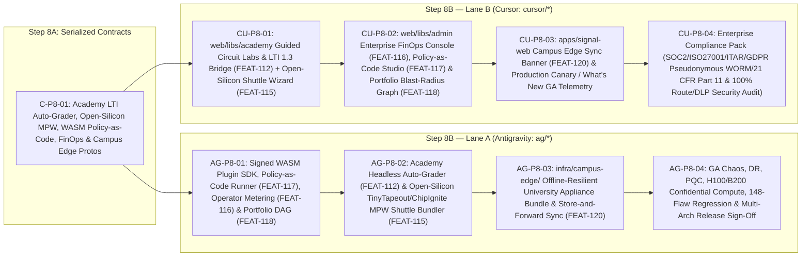

# Phase 8 Plan — Signal Academy, Campus Edge, Enterprise FinOps, Policy-as-Code, Compliance & GA Hardening

> **Phase Goal:** Complete Signal's global educational & enterprise platform capabilities: Guided Interactive Circuit Labs & LTI 1.3 Auto-Grader (`FEAT-112`), Open-Silicon Multi-Project Wafer (`TinyTapeout`/`ChipIgnite`) Shuttle Wizard (`FEAT-115`), Developing-Nation Offline-Resilient `Signal Campus Edge` Appliance (`FEAT-120`), Signed WASM Multi-Physics Plugin SDK & Organization Policy-as-Code Rule-Pack Studio (`FEAT-117`), Enterprise Compute FinOps & Budget-Cap Console (`FEAT-116`), Cross-Project Portfolio Blast-Radius Dependency Graph (`FEAT-118`), and the full OWASP ASVS L3 / Hybrid PQC / Confidential Compute (`H100 CC`/`B200 TEE-I/O`) / SOC2 Type II / ISO 27001 / ITAR / 21 CFR Part 11 / 148-Flaw GA Verification Suite.  
> **Governing Specs:** [`07`](../architecture/07-security-encryption-dlp-and-sftp.md), [`08`](../architecture/08-identity-enterprise-and-project-model.md), [`14`](../architecture/14-universal-scale-accessibility-and-expandability.md), [`15`](../architecture/15-application-security-and-project-isolation.md), [`16`](../architecture/16-architectural-audit-flaws-and-futuristic-innovations.md), [`17`](../architecture/17-extended-feature-specifications-ui-and-rust.md), [`20`](../architecture/20-versioning-release-monorepo-build-and-k8s-topology.md)  
> **Ledgers to Tick:** [`TODO-LEDGER-SHARED-CONTRACTS.md`](./TODO-LEDGER-SHARED-CONTRACTS.md) • [`TODO-LEDGER-ANTIGRAVITY-LANE-A.md`](./TODO-LEDGER-ANTIGRAVITY-LANE-A.md) • [`TODO-LEDGER-CURSOR-LANE-B.md`](./TODO-LEDGER-CURSOR-LANE-B.md)

---

## 1. Execution Wave Order

---

## 2. Step 8A — Serialized Contract Freeze (`contracts/**` ONLY)

### `C-P8-01` — Signal Academy LTI Auto-Grader, Open-Silicon MPW Shuttle, WASM Policy-as-Code, FinOps & Campus Edge Contracts
- **Branch:** `contract/C-P8-01-academy-finops-policy-campus-protos` | **Touched Paths:** `contracts/proto/signal/v1/**`, `contracts/fixtures/academy_finops_*.json`
- **Skills:** `signal-contract-first`, `signal-verification-and-pr-gate`
- **Deliverables:** Finalize Protobuf RPCs (`bigint` SI fields) for `FEAT-112`, `FEAT-115`–`FEAT-118`, `FEAT-120`, and signed WASM Multi-Physics Plugin SDK manifests (`14-*`).
- **Verify & Tick:** `./signal.sh check --target contracts` → Tick `C-P8-01` in [`TODO-LEDGER-SHARED-CONTRACTS.md`](./TODO-LEDGER-SHARED-CONTRACTS.md).

---

## 3. Step 8B — Lane A: Antigravity Parallel Tasks (`ag/*`)

### `AG-P8-01` — Signed WASM Multi-Physics Plugin SDK, Policy-as-Code Runner (`FEAT-117`), Compute Metering (`FEAT-116`) & Portfolio Blast-Radius Graph (`FEAT-118`)
- **Branch:** `ag/AG-P8-01-wasm-policy-finops-portfolio` | **Touched Paths:** `engine/crates/signal-pod/src/wasm_policy_runner/**`, `engine/crates/signal-operator/src/metering/**`, `engine/crates/signal-git-sync/src/portfolio_dag.rs`
- **Skills:** `signal-rust-crate-architect`, `signal-security-isolation-audit`, `signal-release-deploy-topology`
- **Deliverables:**
  1. **`FEAT-117`** (`wasm_policy_runner`: deterministic fuel-capped Wasmtime host executing `ML-DSA-65`-signed custom enterprise DRC/naming/stackup/security rule-packs & multi-physics plugin extensions on every commit, `14-*`).
  2. **`FEAT-116`** (`signal-operator::metering`: per-pod/team/project CPU-core-second, GPU-second, and AI token accounting + soft-warn/hard-cap quota enforcement, `F-098`) and **`FEAT-118`** (`portfolio_dag`: cross-project `.signal/repos.lock.json` & `parts.lock.json` dependency graph + CVE/EOL transitive impact propagator).
- **Verify & Tick:** `./signal.sh check --target rust-pod,rust-operator` → Tick `AG-P8-01` in [`TODO-LEDGER-ANTIGRAVITY-LANE-A.md`](./TODO-LEDGER-ANTIGRAVITY-LANE-A.md).

### `AG-P8-02` — Academy Headless Auto-Grader (`FEAT-112`) & Open-Silicon `TinyTapeout` / `ChipIgnite` MPW Shuttle Bundler (`FEAT-115`)
- **Branch:** `ag/AG-P8-02-academy-autograder-and-mpw-shuttle` | **Touched Paths:** `engine/crates/signal-sim/src/lab_autograder.rs`, `engine/crates/signal-ic/src/mpw_shuttle.rs`
- **Skills:** `signal-rust-physics-and-geometry`, `signal-verification-and-pr-gate`
- **Deliverables:**
  1. **`FEAT-112`** (`lab_autograder`: headless randomized-seed rubric evaluator testing student circuits across fault conditions & generating signed LTI 1.3 gradebook receipts).
  2. **`FEAT-115`** (`mpw_shuttle`: pre-configured open-source PDK stacks for **SkyWater `Sky130`**, **GlobalFoundries `GF180MCU`**, and **IHP `SG13G2`**, enforcing shuttle tile boundary dimensions, fixed pin-ring harness, metal density, antenna rules, and zero-DRC/LVS GDSII/OASIS precheck).
- **Verify & Tick:** `./signal.sh check --target rust-pod` → Tick `AG-P8-02` in [`TODO-LEDGER-ANTIGRAVITY-LANE-A.md`](./TODO-LEDGER-ANTIGRAVITY-LANE-A.md).

### `AG-P8-03` — `infra/campus-edge/`: Offline-Resilient University Appliance Bundle & Store-and-Forward Sync (`FEAT-120`)
- **Branch:** `ag/AG-P8-03-signal-campus-edge` | **Touched Paths:** `infra/campus-edge/**`, `engine/crates/signal-git-sync/src/campus_edge_sync.rs`
- **Skills:** `signal-release-deploy-topology`, `signal-byo-git-and-vault`, `signal-local-mac-dev`
- **Deliverables:**
  1. **`FEAT-120`** (`Signal Campus Edge`): Single-node `k3s` Helm bundle (`infra/campus-edge/`) packaging `signal-cell-wasm`, pre-indexed offline Universal Datasheet DB + Open PDK cache, local quantized Ollama/vLLM server, and `campus_edge_sync` store-and-forward compressed delta replication when campus internet link restores (`14-*`, `17-*`).
- **Verify & Tick:** `./signal.sh check --target k8s,rust-pod` → Tick `AG-P8-03` in [`TODO-LEDGER-ANTIGRAVITY-LANE-A.md`](./TODO-LEDGER-ANTIGRAVITY-LANE-A.md).

### `AG-P8-04` — GA Chaos, Paired-Region DR, Hybrid PQC, `H100`/`B200` Confidential Compute, 148-Flaw Regression & Multi-Arch Release Sign-Off
- **Branch:** `ag/AG-P8-04-ga-chaos-dr-and-release-gate` | **Touched Paths:** `benchmarks/**`, `scripts/tests/**`, `infra/k8s/gitops/**`
- **Skills:** `signal-security-isolation-audit`, `signal-release-deploy-topology`, `signal-verification-and-pr-gate`
- **Deliverables:**
  1. End-to-end automated regression suite verifying all **148 audit flaw mitigations (`F-001`–`F-148`)**: zombie-pod fencing rejection at `signal-egress-proxy`, `< 150 ms` Pre-Copy pod live migration under load, 100% lateral pod drop under Cilium, Padmé `.signal/vault.merkle.sig` rollback rejection, `0.5-ULP` ARM64-vs-x86_64 SPICE bit-parity, and `./signal.sh release cut --dry-run` + Cosign + SLSA L3 + SPDX 3.0 SBOM verification.
- **Verify & Tick:** `./signal.sh check && ./signal.sh image --dry-run` → Tick `AG-P8-04` in [`TODO-LEDGER-ANTIGRAVITY-LANE-A.md`](./TODO-LEDGER-ANTIGRAVITY-LANE-A.md).

---

## 4. Step 8B — Lane B: Cursor Parallel Tasks (`cursor/*`)

### `CU-P8-01` — `web/libs/academy`: Guided Interactive Circuit Labs & LTI 1.3 Bridge (`FEAT-112`) + Open-Silicon Shuttle Wizard (`FEAT-115`)
- **Branch:** `cursor/CU-P8-01-academy-labs-and-mpw-wizard-ui` | **Touched Paths:** `web/libs/academy/src/lib/{lab-runner,open-silicon-wizard}/**`
- **Skills:** `signal-angular-workbench`, `signal-angular-ui-style-system`, `signal-verification-and-pr-gate`
- **Deliverables:**
  1. **`FEAT-112`** (`LabRunnerWorkbench`: split guided lab instructions, live schematic/breadboard canvas, interactive oscilloscope, 1-click "Run Auto-Grader", and Canvas/Moodle/Blackboard LTI 1.3 grade passback) and **`FEAT-115`** (`OpenSiliconShuttleWizard`: step-by-step `1x1` / `2x2` TinyTapeout/ChipIgnite tile wizard for `Sky130` / `GF180MCU` / `IHP SG13G2`).
- **Verify & Tick:** `./signal.sh check --target ui` → Tick `CU-P8-01` in [`TODO-LEDGER-CURSOR-LANE-B.md`](./TODO-LEDGER-CURSOR-LANE-B.md).

### `CU-P8-02` — `web/libs/admin`: Enterprise Compute FinOps Console (`FEAT-116`), Policy-as-Code Studio (`FEAT-117`) & Portfolio Blast-Radius Graph (`FEAT-118`)
- **Branch:** `cursor/CU-P8-02-admin-finops-policy-portfolio-ui` | **Touched Paths:** `web/libs/admin/src/lib/{finops-dashboard,policy-studio,portfolio-graph}/**`
- **Skills:** `signal-angular-workbench`, `signal-angular-ui-style-system`, `signal-security-isolation-audit`
- **Deliverables:**
  1. **`FEAT-116`** (`FinOpsTelemetryDashboard`: real-time CPU/GPU/AI token burn, soft/hard budget alerts, cycle-time velocity metrics), **`FEAT-117`** (`PolicyAsCodeStudioComponent`: author, unit-test, and sign org-wide Rust/WASM or declarative policy packs), and **`FEAT-118`** (`PortfolioDependencyGraph`: interactive cross-project shared-IP & MPN blast-radius graph).
- **Verify & Tick:** `./signal.sh check --target ui` → Tick `CU-P8-02` in [`TODO-LEDGER-CURSOR-LANE-B.md`](./TODO-LEDGER-CURSOR-LANE-B.md).

### `CU-P8-03` — `web/apps/signal-web` & `services/api-gateway`: Campus Edge Sync Banner (`FEAT-120`) & Production Canary / What's New GA Telemetry
- **Branch:** `cursor/CU-P8-03-campus-edge-banner-and-ga-shell` | **Touched Paths:** `web/apps/signal-web/src/app/campus-edge-banner/**`, `services/api-gateway/src/releases/**`
- **Skills:** `signal-angular-workbench`, `signal-angular-ui-style-system`, `signal-fastapi-control-plane`
- **Deliverables:**
  1. **`FEAT-120`** (`CampusEdgeSyncBanner`: LAN appliance status pill, offline datasheet/PDK cache indicator, and store-and-forward BYO-Git upstream sync queue) + full end-to-end `X-Signal-Web-Version` skew negotiation and What's New release feed verification (`20-*`).
- **Verify & Tick:** `./signal.sh check --target api,ui` → Tick `CU-P8-03` in [`TODO-LEDGER-CURSOR-LANE-B.md`](./TODO-LEDGER-CURSOR-LANE-B.md).

### `CU-P8-04` — Enterprise Compliance & AppSec GA Sign-Off Pack (`services/audit-service`, OWASP ASVS L3, GDPR Pseudonymous WORM, ITAR/EAR & 21 CFR Part 11)
- **Branch:** `cursor/CU-P8-04-enterprise-compliance-ga-audit` | **Touched Paths:** `services/audit-service/**`, `web/libs/admin/src/lib/compliance-center/**`
- **Skills:** `signal-security-isolation-audit`, `signal-fastapi-control-plane`, `signal-angular-ui-style-system`, `signal-verification-and-pr-gate`
- **Deliverables:**
  1. Automated compliance evidence generator & Admin Compliance Center (`SOC2 Type II`, `ISO 27001`, `ITAR`/`EAR` sovereign residency attestation, `GDPR` Right-to-Erasure cryptographic `user_pii_salt` shredding verification without mutating RFC-3161 WORM chains `F-100`, and `FDA 21 CFR Part 11` / `ISO 26262` / `DO-254` audit trail inspector).
  2. Full automated verification that **100% of FastAPI routes pass `assert_all_routes_guarded`**, **0 `/export`/`/download`/`/print` routes exist**, **100% of Angular components obey the 4-file split & centralized `@signal/design-system`/`@signal/ui-kit` style rules**, and **100% of `contracts/transcripts/*.jsonl` pass end-to-end**.
- **Verify & Tick:** `./signal.sh check` → Tick `CU-P8-04` in [`TODO-LEDGER-CURSOR-LANE-B.md`](./TODO-LEDGER-CURSOR-LANE-B.md).
